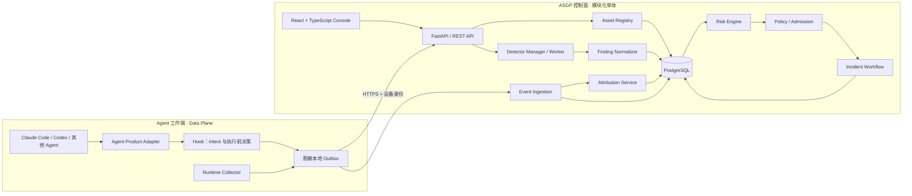

# ASGP 总体架构

**状态：目标架构草案 v0.1**  
**产品：ASGP — Agent Security Governance Platform**  
**当前代码：扫描引擎集成原型；本文件描述目标系统，不宣称所有模块已经实现。**

## 1. 平台定义

ASGP 是一个以 **Agent 运行时安全**为核心、以**检测能力复用**为基础、以**行为归因和治理闭环**为差异化能力的独立平台。

平台要能回答四个问题：

1. 当前接入了哪些 Agent、Skill、MCP Server 和插件？
2. 哪个检测器基于什么证据发现了什么问题？
3. Agent 发起的 Intent 与主机上实际发生的进程、文件、网络行为如何关联？
4. 风险经过什么策略决定、阻断/审批、人工研判、修复和复测后关闭？

静态扫描回答“资产可能有什么问题”；运行时采集回答“实际发生了什么”；归因说明“哪些证据把两者联系起来”；治理负责“谁在什么规则下做了什么处置”。这四类结果不能折叠成单一扫描分数。

## 2. 设计原则

1. **控制面与数据面分离。** 控制面管理资产、策略、扫描、风险和工单；数据面在 Agent 主机采集事件和执行 Hook 决策。
2. **领域模型先于检测器。** 检测器输出 Finding；它不写 Asset 生命周期，不创建 Incident，也不直接执行最终治理动作。
3. **保留原始证据和来源。** 统一模型只做映射，不丢弃上游报告、规则 ID、版本和置信度。
4. **观察不等于阻断。** Adapter 必须按产品和版本声明 observe/confirm/deny 能力；未验证产品回执时不宣称策略已生效。
5. **归因可以未知。** Runtime Event 可以未关联到 Intent；多个可能来源应保留为候选关系。
6. **模型辅助不代替确定性控制。** StepFun/讯飞可用于语义审计、摘要和研判建议；执行前策略仍由确定性 Policy Engine 给出。

## 3. 控制面与数据面

**控制面（Control Plane）**负责资产、检测器、统一结果、风险、策略、准入、Incident、用户权限和审计。

**数据面（Data Plane）**由 Agent Product Adapter、Hook 和主机 Collector 组成，部署在 Agent 运行端。它需要低延迟、可离线排队和最小权限；不能让 Agent 执行路径依赖远端 LLM 响应。

Hook 的同步接口与 Collector 的批量上传接口是不同路径：前者用于产品确实支持的执行前 allow/confirm/block；后者用于异步审计、进程、文件和网络事件。只有产品版本的协议和回执经过验证后，Adapter 才能声明相应能力。

## 4. 六层逻辑架构

| 层 | 名称 | 核心职责 |
| --- | --- | --- |
| L0 | Agent 接入 | 产品、版本、主机身份、Hook 能力和资产清单 |
| L1 | 采集与执行 | Hook、Linux Audit、后续 eBPF；事件脱敏、本地排队、执行前策略点 |
| L2 | 检测引擎 | Skill/MCP/Agent 静态或动态检测；适配器调度、版本、超时和资源限制 |
| L3 | 数据与关联 | Asset、Finding、Execution、Intent、Runtime Event、Attribution、Incident 关系 |
| L4 | 决策与治理 | 风险聚合、Policy Decision、Admission、审批、处置和复测 |
| L5 | 管理与展示 | 资产中心、检测中心、Runtime Explorer、Incident、策略和审计 |

每层只能经由稳定契约调用下一层。Detector 只产出检测观察；Collector 只提交运行证据；领域服务负责状态变化和治理动作。

## 5. 控制面模块

ASGP V1 采用**模块化单体**，先不拆微服务。模块边界如下：

| 模块 | 所有权与职责 |
| --- | --- |
| `asset_registry` | 逻辑资产、实例、版本、来源、主机和产品作用域 |
| `detector_manager` | 检测器清单、版本、能力、运行状态、超时和原始报告 |
| `finding_service` | Finding 标准化、指纹、去重、证据引用和复核状态 |
| `execution_service` | Agent Execution、会话和 Intent 生命周期 |
| `event_ingestion` | 设备鉴权、批量事件、幂等、脱敏和 outbox 回执 |
| `attribution_service` | Intent/Process/Event 候选关联、方法、置信度和证据 |
| `risk_service` | Intrinsic/Runtime/Exposure 维度及可解释聚合 |
| `policy_service` | Allow/Audit/Confirm/Block 决策及规则版本 |
| `admission_service` | 检查、审批、暂存、提交、验证和补偿/回滚 |
| `incident_service` | 研判、定级、分派、处置、复测、关闭和审计 |
| `provider_registry` | StepFun 主用、讯飞候选和 wire API 能力档案；不持久化密钥 |

模块可在同一个 FastAPI 进程内运行，但必须通过服务接口和事务边界交互，不允许 Detector 直接写 Asset 状态或跳过 Policy Service。

## 6. 检测器复用与模型 API

### 6.1 Detector Adapter

每个上游检测器声明 `detector_id`、版本、输入类型、运行模式、网络需求、LLM 需求、许可、能力和输出契约。统一接口包含：

- `health_check()`：检测安装和运行环境。
- `scan(target, context)`：在超时和资源限制内执行。
- `normalize(raw_output)`：转为 Finding 列表，保留 upstream rule ID 和原始证据引用。
- `version()`：返回引擎及规则包版本。

ASGP 复用 SkillSpector、A.I.G Skill/MCP 扫描、Snyk Agent Scan 和 Cisco MCP Scanner；A.I.G 完整平台的纳入决策见 [A.I.G 复用评审](docs/aig-platform-review.zh-CN.md)。

### 6.2 Model Provider Adapter

ASGP 有自己的 REST API；StepFun/讯飞是 **模型供应商 API**，不是 ASGP 管理 API。

模型调用经 `ModelProvider` 接口路由，配置包含 `provider_id`、`base_url`、`wire_api`、`model_id`、Secret 引用和已验证 capability。当前策略为 StepFun primary、讯飞 candidate：

- 当前 Codex 配置中的 StepFun `wire_api=responses`，base URL 为 `https://api.stepfun.com/step_plan/v1`。
- 当前 Codex 配置中的 `xunfei` profile 也是 Responses，base URL 为 `https://maas-api.cn-huabei-1.xf-yun.com/v1`；ASGP 保留为候选，不默认路由。
- 旧平台代码 `OpenAICompatibleModelProvider` 使用 Chat Completions；A.I.G 扫描 CLI 也使用 Chat Completions。因此 StepFun Responses profile 和 StepFun Chat Completions profile 必须分开配置。
- 当前扫描器 profile 由 `STEPFUN_API_KEY`、`STEPFUN_CHAT_BASE_URL`、`STEPFUN_MODEL` 配置；未设显式环境变量时，原型会从 Codex `config.toml` 对应 provider 的 `http_headers.Authorization` 在内存读取 Bearer 值。讯飞扫描器 profile 同样支持 `XUNFEI_API_PASSWORD`、`XUNFEI_CHAT_BASE_URL`、`XUNFEI_MODEL` 覆盖或对应 Codex provider header。密钥只进入指定子进程环境，不进入 API 响应、argv、SQLite 或日志。
- 讯飞 profile 通过 Chat Completions Probe 和能力验收后才能切换；Codex Responses profile 不自动代表扫描器兼容。

### 6.3 模型安全职责

LLM 可产生语义 Finding、摘要和分析员建议；确定性 Policy Engine 决定是否 allow/confirm/block。未经验证的模型输出不能作为单独拦截依据。每次调用记录 provider/model/profile 版本、延迟、token 用量（如果可得）和脱敏状态，不记录密钥。

## 7. Data Plane 与运行时证据

### 7.1 Agent Product Adapter

首批产品为 Claude Code 与 Codex。每个 Adapter 绑定产品版本，映射 SessionStart/End、PreToolUse/PostToolUse 等实际协议到 ASGP Execution/Intent，并提供能力声明。参数和会话正文在端点先脱敏；默认只上传工具、调用 ID、哈希、状态和必要摘要。

### 7.2 Runtime Collector

V1 运行端先限定 Linux。先使用 Linux Audit 验证进程、文件和网络事件覆盖，再据实测差距评估 eBPF。inotify 仅用于文件变化补充，不声称能完整记录文件读取。每个 Collector 记录自身版本、权限、事件覆盖和丢失计数。

端点通过本地 outbox 批量上报；网络不可用时排队并重试。控制面按设备身份覆盖客户端提交的 host/owner/source，不能信任客户端自报主机身份。

### 7.3 Intent-Behavior Attribution

归因链为 `Execution → Intent → Process/Event`，但关系边不是必填。关联证据分为：

| 等级 | 证据 | 用法 |
| --- | --- | --- |
| A | Hook/Tool Call ID 精确关联 | 高置信候选；保留原始 ID |
| B | PID/PPID、Execution 上下文和时间顺序 | 中置信；记录完整进程边 |
| C | 时间、资源、文件路径、网络目标特征 | 弱候选；只供调查，不作为单独因果结论 |

归因算法输出 `method`、`confidence`、`evidence_refs` 和候选数量。没有可用关联时保持 `intent_ref=null`；不得把“同一时间窗口发生”写成确定因果。

## 8. 风险、策略、准入和 Incident

风险评分保留三个维度：

- `intrinsic_risk`：资产内容、来源和版本风险。
- `runtime_risk`：执行过程中观察到的危险行为。
- `exposure_risk`：权限、作用域、联网能力和产品配置带来的暴露面。

不同扫描器分数不直接相加。Finding 先做 fingerprint 去重和来源保留，再由 Risk Service 依据证据、置信度、资产实例和重复性计算可解释判断。

Policy Decision 与 Enforcement Evidence 分开。Admission 在安装/启用前执行 `check → approve → stage → commit → verify → reconcile/rollback`。Incident 关联多个 Finding/Event，工作流为 `open → investigating → confirmed/false_positive → mitigating → verifying → closed`，保留操作者、时间和处置依据。

## 9. 目标技术栈

| 模块 | V1 目标 | 原型现状 |
| --- | --- | --- |
| 后端 | FastAPI + Pydantic v2 + SQLAlchemy 2，模块化单体 | Python 标准库 `ThreadingHTTPServer` |
| 数据库 | SQLite 开发；PostgreSQL 多设备正式环境 | SQLite `data/fusion.db`，只有扫描结果表 |
| 前端 | React + TypeScript | 静态 HTML/CSS/JavaScript |
| Worker | asyncio + 有界任务队列；以后按吞吐拆分 | 请求线程中同步调用 CLI，300 秒超时 |
| 运行时采集 | Claude/Codex Hook + Linux Audit；后评估 eBPF | 尚未实现 |
| 策略 | 内部策略接口，后续评估 OPA | 尚未实现 |

V1 不引入 Kafka、Redis、Neo4j。先用关系表和递归查询表达事件链；只有性能或协作规模测得瓶颈后再拆 Worker、加消息系统或图存储。

## 10. 安全基线与当前限制

- 当前实例因演示需要监听 `0.0.0.0:8000`，尚无登录认证、RBAC 或设备认证；不要将敏感样本放进 `workspace/`。
- Python venv 只隔离依赖，不是 OS sandbox。扫描 Worker 后续应以非 root、只读目标、最小环境变量、无默认外网、资源限制方式运行。
- Provider Key 由本地 `.env`、Codex provider config header 或 Secret Store 提供；只在内存中读取，不能落盘到 ASGP 数据库。
- 只有真正位于执行路径并获得产品确认的 Hook 决策才统计为“阻断”；Linux Audit/eBPF 事件只是观测证据。
- 所有运营指标区分静态 Precision/Recall、Runtime 事件覆盖/丢失/归因 Precision/Recall、治理响应与复测指标。

## 11. A.I.G 复用决策

ASGP 保留 A.I.G 的独立扫描器作为可替换 Detector Adapter，不把其完整 Go/React 控制台、Agent WebSocket Task Runner 和主数据库并入 ASGP 核心。理由包括控制面领域重叠、缺少 ASGP 所需的运行时因果归因，以及上游默认无认证/Agent 容器高权限边界。完整评审见 [docs/aig-platform-review.zh-CN.md](docs/aig-platform-review.zh-CN.md)，决策记录见 `docs/adr/0001`。
