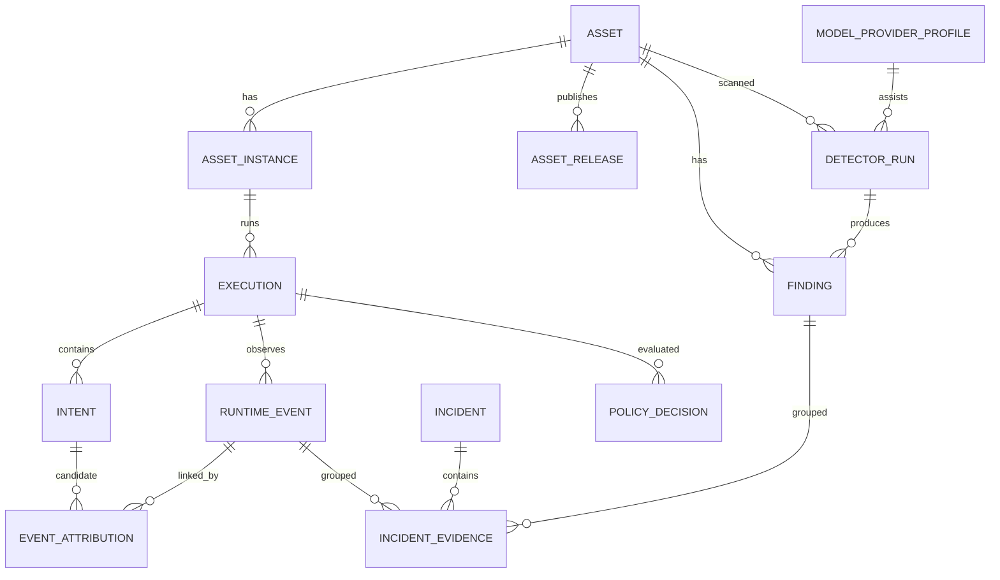

# ASGP 核心数据模型

**状态：目标模型草案 v0.1。** 本文定义未来 ASGP 的业务契约；当前原型 SQLite 只有 `scans` 与 `findings` 两张主要表，尚未实现下列完整模型。

## 1. 关系总览

关系图刻意不把 `RuntimeEvent.intent_id` 设成必填外键：一个事件可以无法归因，也可以保留多个归因候选。

## 2. 实体

### ModelProviderProfile

一个可选择的模型供应商/传输配置。保存 provider ID、角色（primary/candidate）、base URL、wire API、model ID、能力 Probe 状态和密钥环境变量名；只保存 `secret_configured` 布尔状态，不保存密钥本身。

StepFun 是默认 primary，讯飞星火是 candidate。Codex 的 Responses profile 与检测器使用的 Chat Completions profile 是不同配置，不能因为供应商相同就合并 endpoint。

### DetectorRun

一次检测器执行及其原始结果。保存 `detector_run_id`、目标 Asset/Instance、检测模式、detector ID/version、状态、开始/结束时间、超时/错误、原始报告引用和标准化版本。若调用了模型服务，记录 Provider Profile、model ID、wire API 和延迟，不保存 prompt 正文或 key。

### Asset

逻辑治理对象，类型为 `agent | skill | mcp_server | plugin | tool`。建议字段：

| 字段 | 含义 |
| --- | --- |
| `asset_id` | ASGP 逻辑资产 ID |
| `asset_type` | 资产类型 |
| `canonical_name` | 规范名称 |
| `product` | Claude Code、Codex 等 Agent 产品 |
| `publisher` / `namespace` | 发布者与命名空间 |
| `provenance` | 来源和获取渠道，不代表安全结论 |
| `created_at` / `updated_at` | 记录时间 |

### AssetInstance 与 AssetRelease

`AssetInstance` 表示一个主机/产品/作用域中的具体安装或缓存副本，保存 `host_id`、`product_scope`、`install_path`、`installation_state`、`activation_state` 和 `runtime_state`。三种状态相互独立。

`AssetRelease` 表示可验证内容版本，保存 `version`、`content_hash`、`source_uri`、签名/验证状态和发布时间。逻辑资产相同不等于实例相同，实例相同也不保证当前内容与上次扫描一致。

### Finding

检测器观察到的一项问题。建议字段：

| 字段 | 含义 |
| --- | --- |
| `finding_id` | 单条发现项 ID |
| `detector_run_id` | 产生此 Finding 的检测器运行记录 |
| `asset_id` / `instance_id` | 关联逻辑资产/实例；无法关联时为空 |
| `execution_id` | 运行时 Finding 的可选执行上下文 |
| `detector_id` / `detector_version` | 产生结果的引擎及版本 |
| `rule_id` / `upstream_rule_id` | ASGP 规则 ID 和上游规则 ID |
| `severity` | 潜在影响等级；保留上游原始等级映射 |
| `confidence` | 证据支持此 Finding 的置信度，与 severity 分开 |
| `evidence_refs` | 证据引用，不在列表页复制敏感正文 |
| `fingerprint` | 跨扫描去重的稳定指纹 |
| `status` | `new / triaged / resolved / false_positive / reopened` |

保存 `raw_scan_report` 以便重放和重新归一化；标准 Finding 不覆盖或丢弃上游原始输出。

### Execution

一次 Agent 任务/会话的边界，保存 `execution_id`、产品和版本、主机、`session_id`、开始/结束时间、结果状态及关联实例。Execution 不是 PID，也不等同于一个 Agent 进程。

### Intent

由已验证 Agent Adapter/Hook 观察到的一次具体操作请求，例如 Tool Call。保存 `intent_id`、`execution_id`、父 Intent、工具名、产品调用 ID、脱敏参数摘要/哈希、开始/结束时间和产品执行结果。没有 Hook/调用事件时，不从自然语言 prompt 推造 Intent。

### RuntimeEvent

由 Hook、Linux Audit 或未来 eBPF Collector 观察到的行为。保存 `event_id`、`host_id`、`collector_id`、`event_type`、UTC 时间、进程/父进程标识、资源、动作、结果、序列号和证据引用。完整 secret、API Key、任意 prompt 正文默认不进入事件。

### EventAttribution

Intent 与 RuntimeEvent 之间的证据关联记录：`attribution_id`、`intent_id`、`event_id`、`method`、`confidence`、`evidence_refs`、`rule_version` 和时间。支持多个候选边；弱关联不能覆盖强关联，也不能把没有证据的事件强行连接。

### PolicyDecision 与 EnforcementEvidence

`PolicyDecision` 保存策略版本、输入 Finding/Event/Intent 引用、结果 `allow | audit | confirm | block` 和原因。`EnforcementEvidence` 独立证明 Agent 产品实际收到并遵守了该决策；PolicyDecision 本身不是阻断成功证据。

### Incident 与 IncidentEvidence

`Incident` 是人工调查和处置的一组证据，状态为 `open → investigating → confirmed/false_positive → mitigating → verifying → closed`，并保存负责人、严重级别、时间线和处置记录。`IncidentEvidence` 关联 Finding、RuntimeEvent、Execution 或 Attribution；同一 Finding 可重复关联到不同 Incident。

## 3. 身份与去重

- `logical_asset_id`：产品 + 类型 + 规范名称 + 发布者/命名空间。
- `instance_id`：主机 + 产品作用域 + 安装路径。
- `content_hash`：标准化内容摘要。
- `finding_fingerprint`：detector/rule + 资产/实例 + 归一化位置/证据片段。
- `event_id`：端点生成并随上传重试保持稳定；服务端用 `host_id + collector_id + event_id` 做幂等。

同一 Skill 可在 Claude Code 和 Codex 下共享 logical asset，但属于不同 instance；内容相同也不表示权限或运行风险相同。

## 4. 状态与边界

1. **Finding 不是 Risk Assessment。** Finding 是原始检测证据；风险评估可以聚合多引擎 Finding、来源、权限、运行事件和分析员结论。
2. **Risk Assessment 不是 PolicyDecision。** 评分不直接等于 allow/block；策略需有明确作用域和版本。
3. **PolicyDecision 不是 EnforcementEvidence。** 需要 Hook/product 回执或 OS 证据证明决定生效。
4. **RuntimeEvent 可以未归因。** 空 Attribution 是有效结果，不是数据错误。
5. **Admission 与扫描分开。** 扫描结论不代表安装成功、启用成功或产品实际加载。
