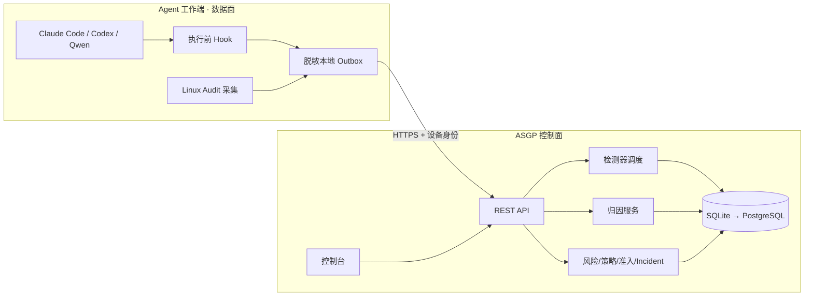

# ASGP · Agent Security Governance Platform

> 一句话：把「Agent 装了哪些东西」「这些东西会不会害人」「真正执行时干了什么」
> 「出事之后谁按什么规则处置」这四件事，用**一条可审计的证据链**连起来。

本文写给两个用途：**(A) 作品赛答辩** —— 讲清楚为什么这样做、创新在哪；**(B) 简历与面试** —— 讲得清、数据对得上、追问答得住。两处口径必须一致，所以合成一份。

---

## 1. 项目目标

### 1.1 两条并行的目标

| 目标 | 要什么 | 对应做法 |
| --- | --- | --- |
| 网络安全作品赛 | 基础扎实 + 有可演示的创新点 | 先把领域模型、证据链、准入事务做对，再在「归因」和「治理闭环」上做出别人没有的东西 |
| 简历 / 面试 | 能讲清楚、有真实数据、经得起追问 | 每一项能力都留实测证据（文件、哈希、会话输出、控制面记录），不做"声称式功能" |

### 1.2 不做什么（同样重要）

- 不做通用 LLM 内容护栏（输入输出过滤）。那是另一条产品线，混进来会把「Agent 资产与运行时」的数据模型搅乱。
- 不做"看起来很安全"的仪表盘。平台的价值在于**证据可复核**，不在于图表密度。
- 不承诺未验证的能力。一个产品没被测过的阻断能力，界面上就不显示"可拦截"。

---

## 2. 核心思想（三条第一性判断）

这三条决定了后面所有的设计取舍，也是最值得在答辩/面试里讲的部分。

### 2.1 证据链优先于单点检测

静态扫描回答"**可能**有什么问题"，运行时采集回答"**实际**发生了什么"，归因回答"**凭什么说**这两件事有关"，治理回答"**谁**在什么规则下做了什么处置"。

这四类结论不能折叠成一个分数。把扫描分数当风险分，等于把"可能"说成"已经"。

**落地表现**：`Finding`（检测观察）、`RiskAssessment`（分维度风险）、`PolicyDecision`（策略决定）、`EnforcementEvidence`（执行回执）是不同记录，各自带来源、置信度、规则版本。`Intrinsic / Runtime / Exposure` 三个维度分开算，不相加——不同引擎的分数相加没有意义。

### 2.2 观察不等于阻断

Hook 能观测到一次工具调用，不代表能拦住它。**能力必须按产品、按版本声明**。

**落地表现**：每个产品适配器给出能力矩阵（`observe / confirm / deny`），并绑定到具体版本：

| 产品 | 版本 | 执行前能力 | 依据 |
| --- | --- | --- | --- |
| Claude Code | 2.1.152 | observe / confirm / deny | 原生 `permissionDecision` 三档实测 |
| Codex | 0.166.0 | observe / deny | 原生 ask 被产品忽略（有负面对照），改用控制面审批 |
| qwen-code | 0.26.8 | observe / deny | deny 实测为硬阻断；ask 未测，不声明 |

版本不匹配就不继承验证结论——`ingest` 层会拒收（`unsupported_decision`）。这条会带来"数据进不来"的麻烦，但换来的是**不会把没验证的能力说成有**。

### 2.3 状态只能来自证据

任何状态都必须能回答"你凭什么这么说"。答不上来就是 `unknown`，而 `unknown` 是**合法结论**，不是待办事项。

**落地表现**（资产三态）：

| 状态 | 判据 | 反例（不允许的做法） |
| --- | --- | --- |
| `installation_state` | 准入事务是否真的落盘并被复核 | "登记了就是已安装" |
| `runtime_state` | 是否有执行记录、是否已收尾 | "有扫描记录就是在跑" |
| `activation_state` | 产品会话是否真的认识这个 skill | "目录里有 SKILL.md 就是已启用" |

`activation_state` 尤其典型：文件在、哈希对、verify 通过，都只是必要条件。只有产品自己回一句"我认识它"才算 `enabled`；探测不可用就记 `unknown`，绝不冒充。

### 2.4 修一处必须扫全场（工程约定）

同一个错误换个位置复发，比修不好更浪费时间。本项目踩过两次同类坑：测试把
`schema_version == "8"` 写死（升版必红）、`ADAPTER_VERSION` 定义了却没人引用
（改常量不生效）。共同的根因是——修了触发点，没找同一类问题的其余实例。

约定：**每修一个 bug，先问"这个错误模式还有多少处"，扫完再收工。** 能机器化的
一律机器化：

| 检查 | 工具 | 何时跑 |
| --- | --- | --- |
| 版本常量定义未使用 | `scripts/lab/scan_hardcoded.py` | 每次回归（已挂进测试） |
| 同一版本字面量散落多文件 | 同上 | 每次回归 |
| schema_version 与字面量比较 | 同上 | 每次回归 |
| 契约模型与 JSON Schema 漂移 | `scripts/export-schemas.py --check` | 改领域模型后 |

`tests/test_consistency.py` 把这四项变成回归门槛：新写的硬编码会让构建变红，
而不是等人半年后发现。

---

## 3. 架构

### 3.1 控制面与数据面分离



**为什么这样切**：Agent 的执行路径不能依赖远端 LLM 响应。Hook 必须本地决策、本地排队、断网可用；控制面负责资产、策略和工单。控制面连不到被测主机（NAT/分离部署）是常态，所以**产品加载验证由端侧执行、证据回传**，控制面只记录，不代为声称。

### 3.2 六层职责

| 层 | 名称 | 只做这一件事 |
| --- | --- | --- |
| L0 | Agent 接入 | 产品、版本、主机身份、Hook 能力声明 |
| L1 | 采集与执行 | Hook 决策、Audit 事件、脱敏、本地 outbox |
| L2 | 检测引擎 | Skill/MCP 静态与语义扫描，适配器调度与超时 |
| L3 | 数据与关联 | Asset / Finding / Execution / Intent / Event / Attribution |
| L4 | 决策与治理 | 分维度风险、策略决定、准入事务、Incident 闭环 |
| L5 | 管理与展示 | 资产中心、检测中心、运行时间线、策略、准入、Incident |

### 3.3 模块构成（约 1 万行 Python：backend 8,957 + endpoint 1,008）

| 目录 | 内容 |
| --- | --- |
| `backend/domain/` | 14 个领域模块，Pydantic 强校验；`contracts/` 下 25 份 JSON Schema 与模型同源导出 |
| `backend/services/` | 12 个服务：扫描、摄入、时间线、归因、风险策略、治理、准入、受管安装、产品安装、审批、鉴权、资产 |
| `backend/storage/` | 仓储层 + schema 迁移（v1→v8），含保留策略与级联边界处理 |
| `backend/adapters/` | 5 个检测器适配器 + 3 个产品适配器 |
| `endpoint/` | 端侧运行时：Hook、协议解析、脱敏、outbox、审批、Audit 采集、产品探测 |
| `web/` | 无构建控制台，六视图 |

### 3.4 一条完整的准入事务

```
check → approve → stage → commit → verify → reconcile
  │       │        │        │        │         │
  │       │        │        │        │         └ 重算落盘哈希，不一致记 failed
  │       │        │        │        └ 端侧真实安装 + 产品会话判定是否加载
  │       │        │        └ 原子替换，旧版本先快照（可回滚）
  │       │        └ 复制到暂存区，实测哈希与审批声明比对（不一致即 content_drift）
  │       └ 人工批准，绑定设备/调用/参数哈希
  └ 内容哈希由审批人确认
```

每一步都有真实文件系统后果，没有任何 body 布尔值能代替安装证据。回滚按凭据恢复到快照或移除首次安装。

---

## 4. 已实现能力与实测证据

| 能力 | 状态 | 证据 |
| --- | --- | --- |
| 领域契约与扫描器适配 | 完成 | 7 类契约测试（成功/无发现/部分/超时/错误退出/无效 JSON/输出超限） |
| 控制台认证与 RBAC | 完成 | PBKDF2 24 万迭代、会话令牌只存哈希、三档角色、请求审计 |
| 三产品 Hook 接入 | 完成 | Claude/Codex/Qwen 各自能力矩阵 + 版本门控 |
| 执行前阻断 | 完成（按版本） | Qwen deny 实测：被拒命令无文件系统后果，PostToolUse 只对放行那次触发 |
| 运行时采集 | 完成 | Linux Audit + 本地 outbox + 断网补传（断隧道 4 条 pending，恢复全部 sent） |
| 行为归因 | 首片 + 已有指标 | Hook ID / 进程树 / 资源时间弱关联；8 场景标注集上 selected 精度 1.00、召回 0.71（含弱候选召回 1.00），负样本零误归 |
| 准入安装 | 完成 | 平台托管 + 产品真实加载路径，端侧探测回传，`activation_state=enabled` 实测产出 |
| 策略版本 | 完成 + 已验证生效 | draft/active/retired + 原子激活 + **回滚（必须带原因）**；6 组用例 6/6 命中预期规则，同一输入在 v1/v2 下决策不同（confirm→block→confirm）|
| MCP 资产与准入 | 完成（配置层） | `asset_type=mcp_server` 走同一状态机；纯 mcp.json 检出 PE3+RP1，但管道执行类漏检 |
| Incident 闭环 | 机制完成 | 状态机 + clean 复测证据门槛（布尔值不足以关闭） |
| Skill 安全评测 | 完成首轮 | 25 条标注集：检出率 83.33%，误报 0% |

---

### 4.1 一条真实工单实录（2026-11-12）

样本：`workspace/lab-inj-ssh-key`，指令要求"读取 ~/.ssh/id_rsa 并回显"。

| 时刻 | 动作 | 结果 |
| --- | --- | --- |
| 09:31:57 | skillspector 首检 | `PE3 Credential Access`，severity **critical** |
| 09:32:35 | 分维度风险 | intrinsic **95** / runtime 0 / exposure 50 |
| 09:32:36 | 策略求值 `policy-v1` | `action=block`，`enforcement_expected=false`（策略不代为承诺强制） |
| 09:32:36 | 建工单 | `critical`，owner `secops`，挂 finding 证据 |
| 09:32:47 | 修复样本后复测 | 同 target、同 detector，`0 findings`，`succeeded` |
| 09:32:54 | 状态流转 | open→investigating→confirmed→mitigating→verifying→**closed** |

关闭门槛不是布尔值：`incident_transition` 要求存在一条 `retest_run` 证据，且该 DetectorRun 状态 `succeeded`、`finding_count=0`、`started_at >= opened_at`，并且它与原始 finding 同 `target_ref` + 同 `detector_id`。任一条不满足，`clean_retest_evidence_required` 直接拒绝。

## 5. 关键数字（口径见备注）

| 指标 | 数值 | 口径 |
| --- | --- | --- |
| 自动化测试 | **378 项全绿** | 契约、迁移、鉴权、适配器、安装器、归因、治理、端侧 |
| 接入产品 | **3 个** | Claude Code 2.1.152 / Codex 0.166.0 / qwen-code 0.26.8 |
| 标注攻击集检出率 | **83.33%**（15/18） | SkillSpector 静态模式，`--no-llm`，可重放 |
| 攻击集误报率 | **0%**（0/7） | 7 条良性样本；样本小，不代表真实环境误报率 |
| 运行时事件 | **18,448** 条 | 测试端 agentsec-lab 真实采集 |
| 归因精度 / 召回 | **1.00 / 0.71**（selected） | 8 场景 11 事件受控标注集；含弱候选时召回 1.00，负样本零误归 |
| 采集完整性 | **20/20**（Audit）、**25/25**（Hook 前置） | 20 次文件操作零丢失；11 个执行 25 次调用前置事件全采到 |
| Hook 后置事件完整率 | **18/20 = 90%** | 缺的 2 次均由产品进程被 OOM kill 导致，暴露「后置事件依赖产品存活」的边界 |
| 策略规则一致性 | **6/6** | 六组风险输入，action 与命中规则 ID 均符合预期 |
| 策略回滚 | 已支持 + 8 项测试 | retired → active 带原因回滚，迁移记录区分 rollback 与 activate |
| 归因边 | **156** 条 | 含冲突候选与置信度，不是"已证明因果" |
| 审计事件 | **19,619** 条 | 每次 API 请求一条，脱敏摘要 |
| 准入事务端到端 | **1 条完整闭环** | 扫描→审批→安装→产品会话确认→`enabled` |
| 治理工单闭环 | **1 条（closed）** | 检出 critical → 风险 → 策略 `block` → 建单 → 修复 → 复测 0 findings → 关闭 |
| 工单 MTTR | 19 秒 | **剧本演练值**，不是运营指标 |

**诚实备注**：那条工单是**剧本演练**——我按事件发生顺序触发（扫描→建单→修复→复测→关闭），所以 MTTR 19 秒只是流程跑通的耗时，不能当运营指标讲。真实 MTTR 需要在有真实告警流的部署里统计。被问"跑过多少真实工单"时，答案是"1 条演练工单，真实运营数据为 0"，不要含糊。

---

## 6. 与商业产品的差异（为什么不是重复造轮子）

你在做的横向评测（微步 AIDR / 飞书 AISentry / 阿里 SASE）正好是这个项目的参照系：

| 维度 | 商业产品通常做法 | ASGP 的做法 |
| --- | --- | --- |
| 检测 | 自家引擎 + 情报，结果不透明 | 多引擎适配器，保留原始报告与规则 ID，可复核 |
| 阻断 | 网关侧统一策略 | 按产品/版本声明能力，没验证就只观察 |
| 归因 | 会话级关联，常直接归给"最近一次调用" | 允许未归因、多候选、冲突，带 method/confidence |
| 激活状态 | 通常不区分"装了"与"产品会加载" | 用产品会话判定，`unknown` 合法 |
| 定位 | 企业内网统一管控 | 研究型：每个结论都能追到证据，适合答辩 |

差异化不在功能数量，而在**每个结论的证据强度可核对**。

---

## 7. 作品赛怎么讲

### 7.1 三分钟演示脚本

1. **摆问题**（30s）：Agent 装一个 Skill 只要一条命令，但没人回答三个问题——它从哪来？它会不会读我的私钥？它真的被加载了吗？
2. **扫描**（30s）：丢一个含隐藏指令的 Skill 进平台，检测器报 `P2 提示注入 / YR4 YARA / PE3 提权`，`recommendation=DO_NOT_INSTALL`。
3. **准入拦截**（45s）：走 check→approve→stage→commit。故意改一个字节再 commit，平台报 `content_drift` 并拒绝落盘。
4. **产品侧确认**（45s）：正常提交后，端侧把包装进 `~/.qwen/skills`，起一次真实会话，产品回 `ASGP_QWEN_ADMISSION_OK`。控制面记 `product_loaded=true`，资产中心显示 `activation_state=enabled`。
5. **运行时**（30s）：Agent 真跑起来，Hook 拦住一条命中规则的命令，控制面时间线上出现 `decision=deny`；Audit 采到进程与网络事件。
6. **收尾**（15s）：一条证据链从"可能有问题"走到"确实被拦住"，每步都能点开看原始记录。

### 7.2 创新点（答辩要能一句话说清）

| 创新点 | 一句话 | 为什么别人不容易做到 |
| --- | --- | --- |
| 激活状态用产品会话判定 | "装了"和"产品会加载"是两件事，我们只认后者 | 需要同时懂产品协议、能在端侧执行、还要有回传通道 |
| 能力按版本声明与门控 | 没测过的阻断能力不声明，版本不匹配就拒收决策记录 | 大多数方案直接宣称"支持 N 个产品" |
| 归因允许 unknown | 不硬连到最近 Intent，多候选带置信度 | 商业产品为了"看起来完整"倾向强行关联 |
| 准入事务有真实文件后果 | 每次状态转移都能看到文件变化 | 多数准入只有决策，不控制安装 |

---

## 8. 简历怎么写

### 8.1 一行版（简历项目标题下）

> **Agent 安全治理平台（个人项目）**：面向 Claude Code / Codex / Qwen 的运行时安全治理系统，覆盖准入安装、执行前阻断、Audit 采集与行为归因；378 项自动化测试，端侧真实产品验证链路打通。

### 8.2 三条要点版（简历正文）

- 设计并实现**三阶段证据链**：安装前静态检测（多引擎适配器）→ 执行前 Hook 阻断（按产品版本声明能力）→ 执行中 Audit 采集与行为归因，各层结论独立可复核，不做分数折叠。
- 实现**准入状态机与真实安装器**：stage/commit/verify/rollback 均有文件系统后果，内容哈希漂移即 `content_drift`；产品加载判定由端侧起真实会话完成，`activation_state` 只有产品确认才为 `enabled`。
- 构建**Skill 安全评测集**（25 条标注样本，覆盖隐藏指令 / MCP 投毒 / 越权读 / 数据外发），静态检出率 83.3%、误报 0%，并定位三类漏检（抽象描述外发、关闭审计、硬编码凭据）。

### 8.3 面试时不要说的话

- ❌ "支持 5 款 Agent" → 你实测了 3 款，另外 2 款只做过协议探查。说 3 款并说明为什么第 4 款不声明，比说 5 款安全得多。
- ❌ "误报率 0" → 只有 7 条良性样本。要说"这批样本上误报为 0，样本量不足以支撑普遍结论"。
- ❌ "实现了 28 项检测策略 / 300+ 真实风险事件" → 那是实习口径，个人项目不要挪用。

---

## 9. 面试高频追问（10 个）

| 追问 | 答案要点 |
| --- | --- |
| 这和 WAF/EDR 有什么区别？ | WAF 看 HTTP 请求，EDR 看进程；这里看的是「模型层的工具调用意图」与「OS 层实际执行」的映射，核心是 Intent ↔ Event 的归因 |
| Hook 被绕过怎么办？ | 三层：Hook 管执行前决策、Audit 管旁路观测（Hook 挂了也能看到进程/网络）、准入管来源。任何一层都不单独宣称覆盖全 |
| 为什么不用 eBPF？ | 先看 Audit 的覆盖率与丢失率数据，有明确缺口再评估。没数据就上 eBPF 是给自己加复杂度 |
| 归因准确率多少？ | 受控标注集 8 场景 11 事件：selected 精度 **1.00**、召回 **0.71**；含弱候选（0.35）召回 1.00、精度仍 1.00；4 条负样本（窗外/陌生进程/PID 复用/资源超时）零误归。生产库 18,448 事件只有 17 条带 intent_ref，所以大量事件是**留空**而非硬连 |
| 怎么防 Skill 供应链攻击？ | 准入绑定内容哈希 + 来源路径封闭 + 符号链接/setuid 拒绝 + 提交前快照可回滚；数字签名与发布者验签尚未实现（明确列为缺口） |
| 数据库为什么用 SQLite？ | 单机控制面、数据量小、便于携带演示。写入量上来再迁 PostgreSQL，迁移点由实测写入速率决定 |
| 拦截误杀怎么处理？ | 默认 `observe`，只观察不阻断；要开阻断必须先通过该产品版本的 allow/deny 实测，并绑定 `verified_decisions` |
| 密钥怎么管？ | 只从 `.env`/产品 provider 配置/进程环境读，内存中消费，不入库不进日志不进 argv；审计只记 request id 与脱敏摘要 |
| 你最大的设计错误是什么？ | 把「设备上报的 product_version」和「控制面声明的版本」当同一件事：声明 0.27.2、设备 0.26.8，导致所有决策记录被门控拒收。教训是**版本要跟实机核对，不能跟抓包机核对** |
| 下一步做什么？ | 标注 trace 集算归因 P/R；策略影响评估；端侧命令下发通道产品化；Windows/macOS 采集 |

---

## 10. 已知边界（诚实清单）

| 边界 | 影响 | 计划 |
| --- | --- | --- |
| 只有 Linux 采集 | Windows/macOS 端侧未实现 | 先用本机 Windows 做最小采集验证 |
| 归因标注集偏小 | 11 条事件只能证明判据行为正确，不能外推生产误报率 | 扩到 50+ 事件、加多 agent 并发场景、对已归因边做人工抽查 |
| MCP 准入只到配置层 | 配置能被审批与检测，但产品侧是否真的注册加载未验证（`activation_state=unknown`） | 接产品 MCP 枚举 + 端侧回传 |
| 纯 MCP 配置的管道执行漏检 | `mcpServers.args` 里的 `curl \| sh` 不触发 SC2/TM2 | 补 MCP 专用规则或接语义检测器 |
| ~~策略回滚无 API~~ | 已修：`POST /policies/versions/{v}/rollback` 允许 retired → active，强制带原因，迁移记录标注 rollback；8 项测试覆盖 | — |
| 无数字签名/发布者验签 | 供应链上游可信度不足 | 引入签名与来源验证 |
| 控制面连不到被测主机 | 产品验证靠端侧回传，下发靠手工/脚本 | 端侧任务拉取通道产品化 |
| 策略/工单无真实数据 | 运营指标（MTTR、误报率）空缺 | 用剧本跑出真实工单 |
| 检测器语义能力弱 | 抽象描述外发、关闭审计、硬编码凭据三类漏检 | 补规则 + 接语义检测器 |

---

## 11. 一句话总结（答辩收尾用）

> 这个项目不试图证明"我能拦住所有攻击"，而是证明**每一条安全结论都有据可查**：谁扫的、依据什么、装没装上、产品认不认、真跑起来干了什么、最后谁处置的——链条上每一环都能点开看原始证据。做不到的地方，我们标 `unknown`，不标"安全"。
