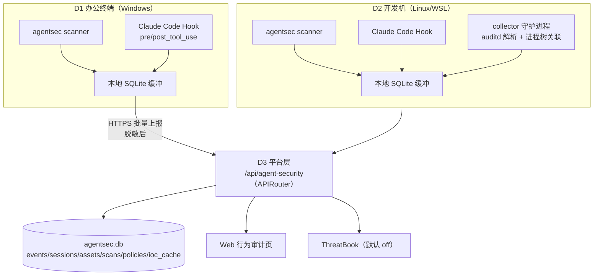

# 平台改造技术落地方案：Agent 安全网关与运行时监控

_把《Agent 运行时安全治理落地文档》的设计落入 llm-security-guardrail-platform 的代码级实施方案 · Last updated: 2026-11-06_

---

## 0. 方案定位

本方案是设计到代码之间的最后一层：明确改哪些文件、加哪些表和接口、按什么顺序做、怎么验证、怎么回滚。设计依据是 `docs/agent-runtime-security-landing.md`（下称"落地文档"），本方案不重复其背景，只做工程化展开。

范围：个人/小团队规模。腾讯云主机（D3）跑平台，办公终端与开发机（D1/D2）跑边缘采集，AutoDL（D4）不部署任何安全组件，保持推理实验链路不受影响（遵守 `AGENTS.md`）。

---

## 1. 前提假设（待确认，影响 Monitor 与 Hook 适配范围）

| # | 假设 | 影响 |
| --- | --- | --- |
| A1 | 设备 = 1 台 Windows 办公终端 + 1 台 Linux/WSL 开发机 + 1 台腾讯云轻量主机；无 macOS | Monitor 全量采集（auditd/eBPF）仅在 Linux 开发机；Windows 只做 Scanner + Hook，Monitor 为明确记录的覆盖缺口 |
| A2 | 在用 Agent = Claude Code 为主，Codex CLI 为辅；MCP 以 filesystem 类和少量自定义 Server 为主 | Hook 配置目标、Scanner 解析目标（`.mcp.json` / `claude_desktop_config.json` / `~/.codex/config.toml`） |
| A3 | 改造范围 = 端到端闭环优先：P0–P2 产出"Scanner + Hook Guard + 平台 API + 审计页面"可演示闭环，P3 补 Monitor，P4/P5 打磨与 POC | 交付顺序 |
| A4 | agent_security 作为现有 FastAPI 进程内的新模块接入（新增 `APIRouter`，不改现有路由） | 部署形态：不新增进程和端口 |
| A5 | 存储 = SQLite 单库文件（`assets_root/agentsec/agentsec.db`），不用 Postgres/ES | 运维成本为零，查询用索引 + 时间范围过滤 |
| A6 | 事件上报粒度 = 元数据 + 参数 SHA-256 + 自动脱敏；明文证据只落本地库，不上传 | 隐私边界 |
| A7 | 微步威胁情报默认 `off`，本期只做接口与缓存预留，P6 再灰度 | 不影响主链路 |

---

## 2. 现状盘点（代码级事实）

| 层 | 现状 | 对本方案的意义 |
| --- | --- | --- |
| 后端入口 | `backend/app/api/main.py`（2028 行），`create_app()` 工厂（`main.py:630`），路由全部为文件内装饰器，无 `APIRouter` 先例 | 新功能必须用 `APIRouter` 挂载，禁止继续往 `main.py` 里堆路由 |
| 配置 | `backend/app/config/settings.py`，pydantic-settings，`LLMSEC_` 环境变量前缀 | 新增 `LLMSEC_AGENTSEC_*` 配置项，零侵入 |
| 事件模型 | `backend/app/schemas/security.py`：`GuardResult`、`ToolCallVerdict`、`allow/block/audit` 枚举 | agent_security 事件模型与动作枚举保持同源，后续可把靶场工具授权记录并入同一事件流 |
| 判定模式 | `backend/app/tools/gateway.py`：`CallerContext` dataclass + 纯函数判定 + verdict | 策略引擎 `policy.py` 复刻这一模式（可单测、无副作用） |
| 存储 | 无数据库；RAG 用 JSON（`assets_root` 下），报告用文件 | agent_security 引入平台第一个 SQLite 库，独立文件、独立目录 |
| 测试 | pytest（`backend/tests/`，38 个文件），`TestClient(create_app())` + `monkeypatch` 环境变量；前端 `node --test src/*.test.mjs` | 新模块按同模式补测试；前端视图逻辑抽到独立 `.js` 再测 |
| 前端 | `web/src/App.jsx`（2039 行）单页 + `navItems`（`App.jsx:48`）+ `i18n.js` 中英文 + `dashboardModel.js` 视图逻辑分离模式 | 新增"行为审计"页遵循同一模式：逻辑进 `agentSecurityModel.js`，`App.jsx` 只接导航和渲染 |
| 部署 | uvicorn `app.api.main:app`，公网 8000（腾讯云） | 平台侧零新增部署单元 |

---

## 3. 目标架构



### 3.1 代码结构（全部新增，不改现有文件逻辑）

```
backend/app/agent_security/
  __init__.py
  models.py      # SecurityEvent / AssetRecord / ScanFinding / ScanReport / PolicyRule / Decision / TIVerdict
  store.py       # AgentSecStore：SQLite DDL + 迁移 + 查询
  rules.py       # 28 条内置检测规则（数据驱动，对齐落地文档第 8 节）
  scanner.py     # SKILL.md / MCP 配置 / Hook 配置 / 依赖文件静态分析
  policy.py      # 决策引擎：decide(event, policies) -> Decision，异常 fail-closed
  redact.py      # 脱敏：密钥/token/密码正则 + 参数 hash
  ti.py          # ThreatBook 客户端 + IOC 缓存 + off/shadow/enforce
  monitor.py     # auditd 事件解析 + ppid 链 -> session_id 关联
  collector.py   # 边缘守护进程：采集循环 + 本地缓冲 + 批量上报 + 重试
  hook.py        # Hook CLI 入口：pre-tool-use / post-tool-use / session-start
  api.py         # APIRouter(prefix="/api/agent-security")
  cli.py         # python -m app.agent_security 子命令入口
backend/tests/fixtures/agentsec/   # 测试样本：evil-skill / clean-skill / mcp-config.json / hook-config.json
backend/tests/test_agentsec_*.py   # 6 个测试文件（见第 9 节）
web/src/agentSecurityModel.js      # 视图逻辑（纯函数，node:test 覆盖）
scripts/agentsec-edge-bundle.sh    # 边缘设备打包（agent_security 目录 + 最小依赖清单）
scripts/agentsec-hook-install.sh    # Hook 安装/卸载的 Linux 便捷包装（主体为跨平台 Python：agentsec guard install）
```

### 3.2 边缘部署形态（关键决策）

边缘设备不安装整个 backend（会拖入 nemoguardrails 等重依赖）。做法：

- `scripts/agentsec-edge-bundle.sh` 把 `backend/app/agent_security/` 打成自包含 bundle（`~/.agentsec/agentsec/`），附带 `requirements-agentsec.txt`（仅 `pydantic`、`pyyaml`、`httpx`）。
- Hook 回调与 collector 统一入口：Linux 为 `~/.agentsec/venv/bin/python -m agentsec <子命令>`，Windows 为 `%USERPROFILE%\.agentsec\.venv\Scripts\python -m agentsec <子命令>`。
- Windows 办公终端（D1）不部署 collector（无 Monitor 采集源）；Hook 回调同步执行，事件写本地 SQLite，由计划任务（或手动）定时调 `agentsec upload` 补传。
- Hook 安装器主体是跨平台 Python 实现（`agentsec guard install`）：自动定位 `settings.json`（Windows `%USERPROFILE%\.claude\settings.json`，Linux `~/.claude/settings.json`），JSON 合并、先备份、幂等；bash 脚本只是 Linux 便捷包装。
- 平台侧（D3）直接从仓库导入同一份代码，`APIRouter` 挂载。**单一事实源仍在仓库**，bundle 只是分发形态。

若后续边缘设备增多，再评估拆成独立包（`packages/agentsec/`），本期不做。

---

## 4. 数据模型

### 4.1 SQLite Schema（`store.py`）

```sql
CREATE TABLE IF NOT EXISTS events (
  event_id TEXT PRIMARY KEY,
  ts TEXT NOT NULL,
  source TEXT NOT NULL,              -- hook | monitor | scanner
  event_type TEXT NOT NULL,          -- tool_call | file_access | net_connect | process_exec | config_change | scan_finding | heartbeat
  host TEXT, host_role TEXT,
  session_id TEXT,
  agent_name TEXT, agent_pid INTEGER,
  tool_name TEXT, tool_server TEXT,
  target_kind TEXT, target_path TEXT, dst_domain TEXT, dst_port INTEGER,
  action TEXT,                       -- allow | ask | block | audit | alert
  rule_ids TEXT,                     -- JSON array
  severity TEXT,                     -- info | low | medium | high | critical
  ti_verdict TEXT,                   -- unknown | clean | suspicious | malicious（默认 unknown）
  evidence TEXT,                     -- JSON，脱敏后
  uploaded INTEGER DEFAULT 0
);
CREATE INDEX IF NOT EXISTS idx_events_ts ON events(ts);
CREATE INDEX IF NOT EXISTS idx_events_session ON events(session_id);
CREATE INDEX IF NOT EXISTS idx_events_host_sev ON events(host, severity);

CREATE TABLE IF NOT EXISTS sessions (
  session_id TEXT PRIMARY KEY, host TEXT, agent_name TEXT, agent_version TEXT,
  user TEXT, cwd TEXT, started_at TEXT, ended_at TEXT
);
CREATE TABLE IF NOT EXISTS assets (
  asset_id TEXT PRIMARY KEY, kind TEXT, name TEXT, version TEXT, path TEXT,
  sha256 TEXT, host TEXT, source TEXT, registered INTEGER,
  first_seen TEXT, last_seen TEXT
);
CREATE TABLE IF NOT EXISTS scans (
  scan_id TEXT PRIMARY KEY, ts TEXT, host TEXT, target_kind TEXT, target_name TEXT,
  target_path TEXT, sha256 TEXT, verdict TEXT, findings TEXT   -- findings 为 JSON
);
CREATE TABLE IF NOT EXISTS policies (
  policy_id TEXT PRIMARY KEY, name TEXT, kind TEXT,   -- path | command | host | ti
  pattern TEXT, severity TEXT, action TEXT, enabled INTEGER, updated_at TEXT, note TEXT
);
CREATE TABLE IF NOT EXISTS ioc_cache (
  ioc TEXT PRIMARY KEY, ioc_type TEXT, verdict TEXT, confidence REAL,
  provider TEXT, fetched_at TEXT, expires_at TEXT
);
```

WAL 模式 + `busy_timeout`，collector 与平台进程可安全并发读写同一库文件。

### 4.2 Pydantic 模型（`models.py`）

与落地文档第 6 节事件 JSON 一一对应；`Decision` 增加 `matched_signals: list[str]` 与 `reason`，对齐现有 `policy.py` 的元数据风格；`TIVerdict` 预留 `provider/verdict/confidence/cached`。

---

## 5. 模块详细设计

### 5.1 Scanner（P1）

- 输入解析：`SKILL.md`（frontmatter + 正文 + 同目录脚本）、`.mcp.json` / `claude_desktop_config.json` / `~/.codex/config.toml`、`package.json` / `requirements.txt` / `pyproject.toml`、`settings.json`（Hook 基线）。
- 规则引擎：`rules.py` 中 28 条规则为数据（`id/name/kind(regex|literal|structural)/pattern/severity/action/targets`），新增规则不改代码。Scanner 输出 `ScanReport`（含逐条 finding 的文件、行号、证据片段）。
- Hash 与登记：对每个目标计算 SHA-256，与 `assets` 表/`registry.json` 比对，输出 `registered` 与 `drift` 标记（S16/S17）。
- CLI：`agentsec scan <path> [--mcp FILE] [--diff] [--json]`，退出码：0 干净 / 1 有告警 / 2 有 block 级发现（供 CI 或人工使用）。

### 5.2 Runtime Guard（P2）

- 策略文件 `policies/guard-policies.yaml`（block_paths / block_commands / ask_commands / prod_hosts），平台侧落 `policies` 表，边缘侧读 YAML——同一份语义，两种载体。
- 决策引擎 `policy.py`：`decide(tool_name, tool_input, ctx, policies) -> Decision`。纯函数，无 IO；任何内部异常按 fail-closed 返回 `block` 并写 `alert` 事件（落地文档 4.6）。
- Hook 协议（Claude Code）：stdin JSON → 决策 → `exit 0`（allow，可附 context）/ `exit 2`（block，stderr 说明原因）/ JSON `{"decision":"ask"}`。安装器（跨平台 Python 实现）把 hooks 合并进现有 `settings.json`：Windows/Linux 路径自动识别，先备份，JSON 合并而非覆盖，幂等。
- 事件上报：pre/post 每次调用写一条 `tool_call` 事件到本地缓冲，collector 统一上传；平台侧 `POST /hooks/decision` 提供同步决策（边缘离线时用本地策略）。
- 防绕过：`settings.json` 与 Hook 回调目录（Linux `~/.agentsec/hooks/`，Windows `%USERPROFILE%\.agentsec\hooks\`）纳入 Monitor 基线（S21/S22），collector 心跳 60s（S23）。

### 5.3 Monitor（P3）

- auditd 规则（`scripts/agentsec-audit.rules`）：敏感路径 `-p rwa`、`execve` 全量、`connect` 可选；`augenrules`/`auditctl` 加载，文档化 root 要求。**仅在 D2 Linux 开发机部署。**
- 解析：读 `/var/log/audit/audit.log`（或 `ausearch -i`），归一化为 `process_exec / file_access / net_connect` 事件。
- 会话关联：`SessionStart` hook 把 `session_id` 写入进程环境并登记 `pid -> session_id`；collector 对每个 execve 沿 ppid 链向上查找已登记 Agent 进程，继承 `session_id`；关联不上的标 `orphan`（S28）。
- Windows（D1）：明确记录为覆盖缺口，只跑 Scanner + Hook；进程/文件/网络采集本期不做，后续可评估 ETW 或轻量轮询补齐（落地文档第 13 节：不假装覆盖）。

### 5.4 脱敏与隐私（P2 起全程生效）

`redact.py` 正则覆盖：`api[_-]?key`、`token`、`password`、`secret`、`Bearer `、AWS AKIA、`-----BEGIN .* PRIVATE KEY-----`。规则：证据入库前统一过一遍；工具参数默认只存 SHA-256；`LLMSEC_AGENTSEC_REDACT=false` 可关（仅限完全本地场景）。

### 5.5 威胁情报预留（P6）

`ti.py`：`ThreatBookClient`（v3 API，超时 2s）+ `ioc_cache` 表（TTL 7 天）+ 每日计数器（软上限 250，硬上限 300）。`LLMSEC_AGENTSEC_TI_MODE=off|shadow|enforce`。密钥只从 `THREATBOOK_API_KEY` 环境变量或 `.agentsec.local.env`（已 gitignore）读取。

---

## 6. API 设计（`api.py`，前缀 `/api/agent-security`）

| 方法与路径 | 作用 | 请求/响应要点 |
| --- | --- | --- |
| `POST /events` | 边缘批量上报 | body 为事件数组；响应 `{"accepted": n, "rejected": [...]}`；按 `event_id` 去重 |
| `GET /events` | 事件检索 | query：`host/severity/rule_id/source/event_type/from/to/limit` |
| `GET /sessions` | 会话列表 | 含事件数、最高严重级、起止时间 |
| `GET /sessions/{id}` | 会话详情 | 进程树 + 工具调用 + 文件/网络时间线（按 ts 排序） |
| `GET /assets` | 资产台账 | 按 kind（agent/mcp/skill）过滤，含版本、hash、登记状态 |
| `POST /assets/scan` | 重新扫描 | 触发 Hash 漂移检测，写 `scans` 表 |
| `GET /scans` | 扫描报告列表 | 按 host/verdict 过滤 |
| `GET /policies` / `PUT /policies` | 策略查看/变更 | 变更写审计事件，禁物理删除（软禁用） |
| `POST /hooks/decision` | Hook 同步决策 | body：tool_name + tool_input + ctx；响应 Decision |
| `GET /stats` | 看板指标 | 事件量、阻断量、按规则/主机/严重级分布、TI 用量 |

鉴权：个人部署默认内网/本机信任；如 D3 公网暴露，`POST /events` 加共享密钥头（`X-AgentSec-Key`，配置项 `LLMSEC_AGENTSEC_UPLOAD_KEY`），默认留空即不校验——**此项需在 P4 前确认**（见第 12 节）。

---

## 7. 前端改造

- `web/src/App.jsx`：`navItems` 增加 `{ id: "agentsec", labelKey: "nav.agentsec", icon: ShieldCheck }`；新增视图分支，渲染逻辑全部委托 `agentSecurityModel.js`。
- `web/src/agentSecurityModel.js`：纯函数（事件过滤、会话分组、进程树构建、严重级排序、误报标记状态机），配 `agentSecurityModel.test.mjs`（`node --test`）。
- 页面：会话列表 / 会话详情（进程树 + 时间线）/ 资产台账 / 事件检索 / 统计看板。策略管理页 P4 之后可选。
- `web/src/i18n.js`：补 `nav.agentsec` 及页面文案的中英文键。

---

## 8. 配置项（`settings.py` 新增，`LLMSEC_AGENTSEC_` 前缀）

| 配置 | 默认值 | 说明 |
| --- | --- | --- |
| `AGENTSEC_DB_PATH` | `{assets_root}/agentsec/agentsec.db` | 平台侧库文件 |
| `AGENTSEC_UPLOAD_URL` | `http://127.0.0.1:8000/api/agent-security/events` | 边缘上报地址 |
| `AGENTSEC_UPLOAD_KEY` | 空 | 上报共享密钥（空 = 不校验） |
| `AGENTSEC_REDACT` | `true` | 上传前脱敏 |
| `AGENTSEC_TI_MODE` | `off` | off / shadow / enforce |
| `AGENTSEC_TI_DAILY_BUDGET` | `250` | 每日查询软上限 |
| `AGENTSEC_HEARTBEAT_SECONDS` | `60` | collector 心跳间隔（S23） |

---

## 9. 实施计划

| 阶段 | 工期 | 改动文件 | 产出 | 验收 |
| --- | --- | --- | --- | --- |
| P0 资产发现 | 第 1–2 天 | `models.py`、`store.py`、`cli.py`(assets 子命令)、fixtures | 资产清单 + SQLite 台账 | D1–D3 的 Agent/MCP/Skill 100% 入库 |
| P1 Scanner | 第 3–5 天 | `rules.py`、`scanner.py`、`cli.py`(scan)、测试 | 28 条规则 + ScanReport | 对 fixtures 中恶意样本检出率 100%，干净样本 0 误报 |
| P2 Runtime Guard | 第 6–8 天 | `policy.py`、`redact.py`、`hook.py`、`cli.py`（guard 子命令）、`scripts/agentsec-hook-install.sh`、policies yaml、测试 | PreToolUse block/ask 生效 + 决策审计 | T07/T08/T10 按策略动作；Windows/Linux 双端 settings.json 合并与卸载回滚均验证 |
| P3 Monitor | 第 9–11 天 | `monitor.py`、`collector.py`、`scripts/agentsec-audit.rules`、systemd unit、测试 | 会话时间线可回放（仅 D2 Linux） | T12 进程链关联 ≥95%；S23 失联告警可达；Windows 侧记录为覆盖缺口 |
| P4 平台与前端 | 第 12–13 天 | `api.py`、`main.py`（挂载一行）、`settings.py`、`agentSecurityModel.js`、`App.jsx`、`i18n.js`、测试 | 全链路打通 + 审计页面 | 事件完整率 ≥99%；页面可演示 |
| P5 POC 与调优 | 第 14 天 | T01–T15 执行记录、规则修订 | POC 报告 | 阻断用例 100% 按预期；误报率 <20% |
| P6 TI 灰度（可选） | 之后两周 | `ti.py` 完善、shadow 运行 | 一致率报告 | 一致率 >90% 且日均 <100 次后切 enforce |

并行原则：P2 的 Hook 决策引擎与 P4 的平台 API 无依赖，可并行；P3 依赖 P2 的 session 登记。

---

## 10. 测试策略

- `test_agentsec_scanner.py`：每条规则至少一个命中 fixture + 一个干净 fixture；Hash 漂移场景。
- `test_agentsec_policy.py`：决策矩阵（block/ask/allow/audit）+ fail-closed 异常路径 + 生产主机升级。
- `test_agentsec_hook.py`：stdin JSON → 退出码协议全分支（含超时与异常）。
- `test_agentsec_store.py`：DDL 迁移、去重上报、查询过滤。
- `test_agentsec_api.py`：`TestClient(create_app())` 覆盖全部 10 个端点。
- `test_agentsec_ti.py`：off 模式不发起请求；shadow 只记录；缓存命中与预算上限。
- 前端 `agentSecurityModel.test.mjs`：进程树构建、时间线排序、过滤逻辑。
- 回归准入：现有 38 个 pytest 文件 + 前端 `node --test` 全绿才允许合入。

---

## 11. 风险与回滚

| 风险 | 缓解 |
| --- | --- |
| `main.py` 继续膨胀 | 新代码全部走 `APIRouter`，`main.py` 只加挂载语句 |
| Hook 安装破坏现有 `settings.json` | 安装器先备份、JSON 合并而非覆盖、提供 `agentsec-hook-uninstall` |
| auditd 规则影响开发机性能 | execve 全量仅在 D2；规则可一键卸载；文档标注 root 要求 |
| 误伤日常开发 | block 清单保持保守，不确定的一律 ask；平台可一键加例外 |
| 脱敏遗漏导致密钥外泄 | `redact.py` 单测覆盖常见格式；上报前强制过脱敏（`REDACT=false` 需显式配置） |
| 影响现有护栏/评测链路 | 独立路由前缀、独立库文件、独立前端页；AutoDL 不部署 |
| Windows 办公终端无 Monitor 覆盖 | 明确记录为缺口并写入文档；该机只跑 Scanner + Hook；后续评估 ETW/轻量轮询，本期不假装覆盖 |

回滚：feature 分支随时可弃；`agentsec-hook-uninstall` 移除 Hook 与 auditd 规则；删除 `agentsec.db` 即清空平台侧数据，不影响现有 JSON 资产。

---

## 12. 验收标准

- 资产发现覆盖率：D1–D3 的 Agent/MCP/Skill 100% 登记。
- 策略验证：T07/T08/T10/T14 100% 按预期动作（block/ask + 留痕）。
- 会话关联率：Agent 进程 → session ≥95%（Linux 侧）。
- 事件完整率：断网缓冲补传后 ≥99%。
- 误报率：P5 后 <20%，两周内降到 <10%。
- 回归：现有测试全绿；新增测试覆盖率核心模块 100%。

---

## 13. 与现有文档的关系

- 设计来源：`docs/agent-runtime-security-landing.md`（本方案是其代码级展开，如冲突以本方案的工程约束为准）。
- 对外表述：`docs/agent-security-resume-project.md`（实现完成后需回填真实运行数据）。
- 仓库规约：`AGENTS.md` Working Rules（密钥、禁推送、禁 MVP 交付）全程适用。
