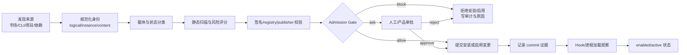
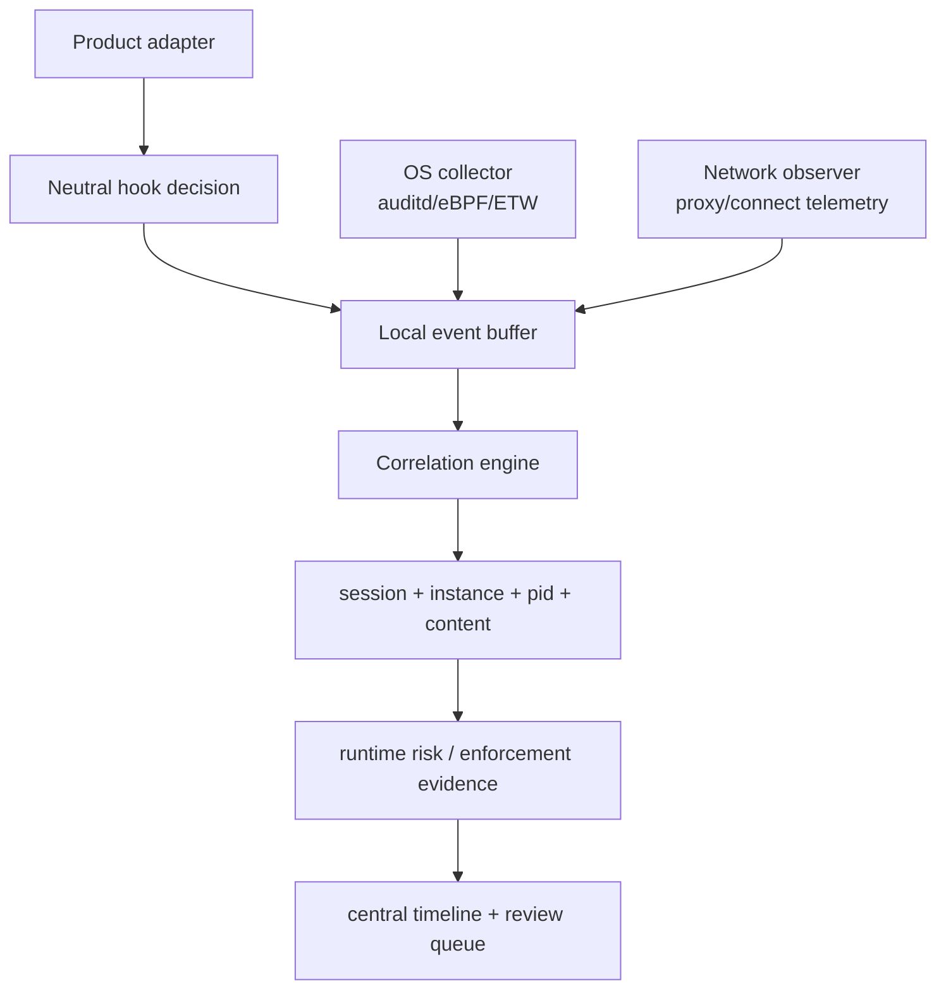

# Agent Security 完整供应链准入与全产品运行时覆盖设计

_设计版本：1.1 · 2026-11-09 · 根据技术评审修订_

## 0. 设计结论

完整能力由两条互相配合的链路组成：

1. **供应链准入**在资产写入、安装、启用和更新前做决定，并把决定绑定到具体的 logical asset、physical instance、content hash、carrier 和 state。
2. **运行时覆盖**在 Agent 工具调用、Skill/MCP 加载、进程执行、文件访问和网络连接发生前后采集证据，并根据产品真实支持的协议执行 allow、ask 或 deny。

“发现了产品”不等于“能阻断产品”。每个产品必须单独记录能力等级、协议证据、信任门、绕过方式和最近验证时间。

## 0.1 v1.1 评审修订原则

本版收敛第一期范围，优先完成 Claude Code、Codex CLI 和 MCP 生命周期的准入与运行时闭环。Cursor、Windsurf、Gemini CLI、Qwen Code、OpenClaw、Hermes、OpenCode、Aider、Step Code 等产品先保持 L0/L1，直到有真实版本协议 fixture。

本版对 v1.0 的关键修订：

- 资产身份从 `logical asset + instance` 扩展为 `logical asset + asset release + physical instance`。
- 安装、启用、运行状态拆成三个维度，不再用一个字段表达不同事实。
- Admission Policy、Admission Enforcement、Commit Verification、Audit 分层。
- 安装更新采用不可变 release 目录、原子引用切换、幂等键、补偿和对账，不假设外部产品提供原子事务。
- Tool Hook、Host Telemetry、Network Control 分开验收；auditd/eBPF 观察不等于执行阻断。
- Integrity、Trust、Risk 三种判断分离；`unknown` 必须保留原因。
- `runtime_enforcements` 独立于普通 runtime events，只有产品回执或可验证结果才计入阻断率。

## 1. 目标与边界

### 1.1 目标

- 未登记、哈希漂移、签名无效、高风险或来源不允许的资产不能被安装或启用。
- 插件市场缓存、vendor dependency 和 synthetic fixture 保留在库存，不被误报为已安装资产。
- 每个准入决定可追溯到输入证据、策略版本、审批人、时间和最终写入结果。
- Claude Code、Codex CLI 及后续产品按同一套中立 Decision 模型执行产品特定的 Hook 协议。
- 没有产品级阻断协议时，系统明确显示 discovery/observe 覆盖，不把旁路监控描述成阻断。
- Hook、配置门、进程监控、auditd/eBPF、网络观察和平台审计都能关联到同一 host/session/instance。

### 1.2 边界

- 本设计不把 ThreatBook reputation 当作唯一恶意结论。
- 本设计不把静态 scanner 的 `block` 当作 `confirmed_malicious`。
- 本设计不假设所有 Agent 产品存在可写、可信、可阻断的 Hook。
- eBPF 只有完成真实实现和验收后才能列入产品能力矩阵；auditd 与 eBPF 是不同采集源。
- Windows、Linux/WSL、macOS 的覆盖必须分别声明；某个平台的能力不能自动继承到另一个平台。

## 2. 统一领域模型（v1.1）

```text
logical asset       = ecosystem | kind | canonical_name | publisher | namespace
asset release       = logical asset | version | content hash | signature | source URI
physical instance   = host | user | product | carrier | canonical_path | release
admission decision  = allow | ask | block + evidence + policy version
runtime coverage    = observe | ask | deny + product/protocol evidence
```

### 2.1 三层资产身份

#### Logical asset

Logical asset 表示跨主机、跨路径的产品级身份：

```text
logical_id = sha256(ecosystem | kind | canonical_name | publisher | namespace)
```

`publisher` 或 `namespace` 缺失时必须保留 `unknown`，不能仅凭同名把两个来源归并为同一 logical asset。

#### Asset release

Release 表示一个可安装、可验证、可回滚的版本：

```text
release_id = sha256(logical_id | version | content_hash | source_uri)
```

Release 至少记录：`version`、`content_hash`、`signature`、`publisher`、`source_uri`、`released_at`、`revoked_at`。同一 logical asset 的不同版本是不同 release；同名不同发布者或不同 hash 不能共用 release。

#### Physical instance

Instance 表示某台主机、某个用户、某个产品载体路径上的实际副本：

```text
instance_id = sha256(host | user | product | carrier | canonical_path | release_id)
```

Instance 绑定 `release_id`，并记录安装、启用、运行和移除证据。旧 `asset_id` 只做兼容读取，不能作为 release 或 logical asset 身份。

#### 依赖闭包

Skill、MCP 或 Plugin 的准入对象包含依赖闭包。每条依赖记录：

```text
parent_instance_id
dependency_type        # npm | pypi | executable | docker | config | env | api | asset
requested_version
resolved_version
resolved_hash
source_uri
resolution_status      # resolved | dynamic | unknown | failed
```

`npx -y package`、未锁定的 PyPI/npm 依赖、动态下载和未知 executable 必须标记 `resolution_status=dynamic|unknown`，不能被当作已验证供应链。

### 2.2 三个独立生命周期维度

```text
discovery_state:    discovered | unknown
installation_state: cached | installed | removed
activation_state:   enabled | disabled
runtime_state:      idle | active | terminated
```

每个维度独立升级，状态不能互相覆盖。一个实例可以同时是 `installed + disabled + idle`，也可以是 `installed + enabled + active`。

最低证据：

| 状态 | 最低证据 |
| --- | --- |
| `discovery_state=discovered` | 文件、目录或配置被发现 |
| `installation_state=cached` | 明确属于市场/插件缓存，未发现产品安装引用 |
| `installation_state=installed` | 安装记录、产品引用或可信 installer 事件 |
| `activation_state=enabled` | 产品启用配置或有效 registry 引用 |
| `runtime_state=active` | Hook 加载、进程加载、工具调用或 last_used |
| `activation_state=disabled` | 产品禁用配置或撤销记录 |
| `installation_state=removed` | 后续 inventory 明确确认实例不存在，并记录确认时间/来源 |

路径本身不能把 `discovery_state=discovered` 推断成 `installation_state=installed`。一次扫描未发现文件也不足以证明实例已 removed，必须有连续 inventory 或产品卸载证据。

### 2.3 可信度层级

证据按强度排序，但强证据也不能越过策略：

1. 签名和可信 publisher 证明内容完整性。
2. registry/allowlist 证明组织允许该 logical asset。
3. 产品配置引用证明实例将被启用。
4. Hook/process/load 事件证明实例实际使用。
5. 静态 finding、ThreatBook 和行为观察提供风险信号。

## 3. 供应链准入架构



### 3.1 准入分层

准入不是一个有副作用的纯函数，而是四层协作：

1. **Admission Policy Engine**：只读取 evidence 和 policy，输出 allow/ask/block；无文件写入、无配置修改。
2. **Admission Enforcement**：检查调用方权限、decision TTL、幂等键和写入入口，拒绝绕过 policy 的直接写入。
3. **Commit Verification**：重新计算 release hash，读取产品配置，确认产品反馈和实际引用；失败时执行补偿。
4. **Audit & Inventory**：保存不可变 decision/approval/commit 事件，并更新 instance 的安装、启用和运行状态。

### 3.2 准入检查顺序

所有安装、更新、启用入口都必须调用同一个纯函数 gate，顺序固定：

1. **身份完整性**：kind、product、name、host、path、logical_id、instance_id、content_hash 可计算。
2. **载体资格**：`marketplace_cache`、`vendor_dependency` 默认不是安装来源；`synthetic` 只允许实验策略显式放行。
3. **内容一致性**：当前 content hash 与提交 hash、registry hash、锁文件 hash 一致。
4. **签名与 publisher**：签名缺失、无效、publisher 不允许时 block 或 ask，不能静默放行。
5. **静态风险**：高风险候选、confirmed malicious、哈希漂移按策略 block；suspicious 至少 ask。
6. **许可范围**：host、project、user、product scope 与策略匹配。
7. **审批约束**：ask 必须绑定精确的 instance/content/policy/version，审批不能跨资产复用。
8. **写入前锁**：在真正写配置或执行 installer 前再次检查 content hash，防止 TOCTOU。
9. **提交记录**：写入成功后记录 commit 结果和产品反馈；写入失败不能标记 enabled。

### 3.3 AdmissionDecision

```json
{
  "decision_id": "adm-20261109-abc",
  "action": "block",
  "logical_id": "sha256...",
  "instance_id": "sha256...",
  "release_id": "sha256...",
  "content_hash": "sha256...",
  "publisher": "official-team",
  "namespace": "registry.example",
  "carrier": "marketplace_cache",
  "requested_state": "enabled",
  "policy_version": "registry-12",
  "checks": [
    {"name": "identity", "passed": true},
    {"name": "carrier", "passed": false, "reason": "cache is not install evidence"},
    {"name": "signature", "passed": false, "reason": "signature missing"},
    {"name": "risk", "passed": true}
  ],
  "reason": "asset is a cache copy and has no valid signature",
  "created_at": "2026-11-09T...Z",
  "expires_at": "2026-11-09T...Z"
}
```

Decision 是不可变审计记录。重新检查产生新 decision_id，不能覆盖旧结论。

### 3.4 安装/启用事务

外部 Agent 产品通常没有真正的安装事务 API，因此不能假设两阶段写入可以原子回滚。安装器必须使用不可变 release 目录、原子引用切换和补偿对账：

```text
prepare -> admission check -> approval -> stage release -> verify
        -> atomic pointer/config switch -> product feedback -> commit
                                             \-> compensate + reconcile
```

- 每个 release 使用独立不可变目录，启用通过 `current` 指针或配置引用切换完成。
- `prepare` 创建 staging，不改变产品配置；`write` 只写 release/staging。
- `verify` 重新计算 hash、检查符号链接/所有权/权限、读取产品配置并确认产品接受该引用。
- `commit` 才把 instance 标为 installed/enabled，并绑定 `idempotency_key`。
- 失败时执行补偿：恢复旧指针、删除 staging、标记 commit failed，并启动 reconciliation；不能声称 rollback 已恢复产品内部状态，除非产品回执确认。

### 3.5 Gate API

```text
POST /api/agent-security/admission/check
POST /api/agent-security/admission/approve
POST /api/agent-security/admission/commit
POST /api/agent-security/admission/rollback
GET  /api/agent-security/admission/decisions/{decision_id}
GET  /api/agent-security/admission/reconcile/{instance_id}
```

`commit` 必须携带 `decision_id`、`idempotency_key`、实际写入后的 release/content hash、产品反馈和 instance_id。服务端拒绝过期、已使用、哈希变化、release 不匹配或 scope 不匹配的 decision。

## 4. 全产品运行时覆盖架构

### 4.1 四个覆盖等级

| 等级 | 含义 | 能否声称阻断 |
| --- | --- | ---: |
| L0 inventory | 只发现 Agent/配置/资产 | 否 |
| L1 observe | 进程、文件、网络或配置旁路观察 | 否 |
| L2 ask | 工具调用前能暂停并取得产品审批 | 部分，可以声称 ask |
| L3 deny | 工具/加载/执行前能可靠拒绝，协议已实测 | 是 |

产品能力矩阵必须为每个 event 写明等级，不能只给产品一个总 tier。

### 4.2 产品适配器契约

每个 adapter 必须实现并声明：

```text
capability_id
product + version range
platform
pre_tool event and input schema
skill/mcp load event, if available
post_tool/session event
allow/ask/deny wire protocol
exit code semantics
config path and trust model
managed-settings support
hash pinning behavior
bypass flags and audit source
last_verified_at
evidence links or fixture IDs
```

只有通过真实产品版本 fixture 的 adapter 才能标为 L2/L3。

### 4.3 目标产品矩阵

| 产品 | 当前 | 目标覆盖 | 目标实现 |
| --- | --- | --- | --- |
| Claude Code | L3 Hook | L3 | PreToolUse deny/ask、managed settings、信任/hash 基线 |
| Codex CLI | L3 Hook adapter | L3 | PreToolUse JSON、hook trust、managed hooks、绕过审计 |
| Cursor | L0/L1 | L2/L3（需协议验证） | 官方 hook/extension 或受控 launcher；未验证前保持 L1 |
| Windsurf | L0/L1 | L2/L3（需协议验证） | 产品事件或 launcher；不复制 Claude 配置假设 |
| Gemini CLI | L0/L1 | L2/L3（需协议验证） | 版本化事件 schema、配置信任和回归 fixture |
| Qwen Code | L0/L1 | L2/L3（需协议验证） | 官方 hook 或 wrapper，记录版本边界 |
| OpenClaw | L0/L1 | L1/L2 | 进程/配置/加载观察；无可靠协议前不声称 deny |
| Hermes | L0/L1 | L1/L2 | 进程和配置观察，后续验证生命周期 API |
| OpenCode | L0/L1 | L2/L3（需协议验证） | 版本化 adapter，不以 MCP 配置存在推断 hook |
| Aider | L0/L1 | L1/L2 | wrapper/进程观察，明确 shell bypass |
| Step Code | L0/L1 | L2/L3（需协议验证） | 生命周期事件、MCP 工具授权和版本 fixture |
| WorkBuddy/Qcode | L0/L1 | 待验证 | 只纳入 inventory，直到有可复现协议证据 |

### 4.4 运行时事件流



Correlation key：

```text
host + session_id + agent_pid/process ancestry + logical_id/instance_id + time window
```

关联失败时保留 `orphan=true`，不能把 orphan 事件伪造为已关联 Agent 事件。

### 4.5 运行时控制点

| 控制点 | 目的 | 最低等级 |
| --- | --- | ---: |
| Tool pre-call | 阻止危险命令、敏感路径、MCP 高风险工具 | L2/L3 |
| Skill/MCP load | 防止高风险资产被加载 | L2/L3 |
| Config change | 防止未通过 admission 的资产被启用 | L3 或受控写入器 |
| Process exec | 发现 installer/lifecycle script/子进程 | L1 |
| File access | 关联敏感读取和资产路径 | L1 |
| Network connect | 关联外联、IOC 和 R005 | L1；阻断需 egress path |
| Hook/config tamper | 发现 hook 删除、hash 漂移、trust bypass | L1/L3 取决于产品 |

Tool pre-call 不等于操作系统执行控制。运行时必须分成三层分别验收：

| 控制层 | 控制对象 | 能证明什么 |
| --- | --- | --- |
| Agent/LLM 层 | Tool Call、MCP、Skill resolution | 产品在工具调用或加载前执行了 allow/ask/deny |
| Host 层 | process、file、IPC、子进程 | Agent 派生出的实际 OS 行为；旁路观察不自动阻断 |
| Network 层 | DNS、TCP、HTTP、出口代理 | 目的地址和流量控制；没有 in-path 控制时只能 observe/enrich |

Skill/MCP load 必须拆成事件：

```text
skill_discovery -> skill_resolution -> skill_activation -> skill_content_read
mcp_config_read -> mcp_server_spawn -> mcp_initialize
  -> mcp_tool_registration -> mcp_tool_invocation -> mcp_server_termination
```

配置写入、MCP 进程启动和工具调用是三个不同的控制点，不能用一个 `load` 事件代替。

### 4.6 运行时上下文与数据最小化

每个 Decision 输入统一包含：

```json
{
  "host_id": "host-001",
  "user_id": "user-001",
  "session_id": "session-001",
  "agent_product": "codex",
  "agent_version": "x.y.z",
  "process": {"pid": 1234, "parent_pid": 1000},
  "instance_id": "instance-001",
  "event": {"type": "tool_pre_call", "tool_name": "Bash", "arguments_hash": "sha256..."},
  "policy_context": {"project_scope": "project-001", "trust_level": "untrusted"}
}
```

命令参数、文件内容、环境变量和网络数据默认只保存 hash、脱敏 span 和结构化字段；原文需显式开关、最小保留期限和审计权限。

### 4.7 失败与降级策略

| 场景 | 准入 | 运行时 |
| --- | --- | --- |
| 平台不可用 | 本地 registry/hash gate 继续阻断 | 本地 Hook 继续执行 |
| Hook stdin 无法解析 | block，写 payload_error | fail-closed |
| 产品不支持 Hook | 不安装伪 Hook | 保持 L0/L1，UI 显示未覆盖 |
| auditd/eBPF 停止 | 不影响安装 gate | heartbeat overdue + coverage degraded |
| 配置 hash 变化 | 要求重新 review/admission | block 或禁用旧 instance |
| provider/TI 超时 | unknown，不清除本地风险 | 不改变本地 enforcement |
| 审计库不可写 | 记录本地失败计数 | Hook 决策继续 fail-closed |

## 5. 风险、信任和完整性决策

Integrity、Trust、Risk 分开计算，再进入 Policy Decision：

```text
Evidence Layer
  -> integrity_status  (hash/signature/release)
  -> trust_level       (publisher/namespace/allowlist)
  -> risk_level        (static/TI/runtime)
  -> evidence_confidence + unknown_reason
  -> Policy Decision (allow/ask/block)
```

示例：哈希不一致是完整性失败，不能被“低风险行为”抵消；依赖解析失败是 `unknown`，必须保留 `unknown_reason`，不能默认为 clean。

## 6. 存储和审计

### 6.1 新增表

```sql
admission_decisions(
  decision_id, logical_id, release_id, instance_id, content_hash,
  requested_state, action, policy_version, checks_json,
  reviewer, created_at, expires_at, committed_at, rolled_back_at
)

asset_releases(
  release_id, logical_id, version, publisher, namespace, content_hash,
  signature, source_uri, released_at, revoked_at, resolution_status
)

asset_dependencies(
  parent_instance_id, dependency_type, package_name, requested_version,
  resolved_version, resolved_hash, source_uri, resolution_status
)

admission_commits(
  commit_id, decision_id, product, version, config_path,
  before_hash, after_hash, product_feedback, result, error, ts
)

product_capabilities(
  product, version_range, platform, capability_id, level,
  protocol_evidence, last_verified_at, trust_model, bypasses
)

runtime_coverage(
  host, product, session_id, capability_id, level,
  last_observed_at, last_enforced_at, heartbeat_age, degraded_reason
)

runtime_events(
  event_id, host, session_id, pid, parent_chain, instance_id,
  event_type, action, enforcement_evidence, orphan, ts
)

runtime_enforcements(
  enforcement_id, event_id, requested_action, actual_action,
  product_ack, exit_code, enforcement_result, adapter_version, ts
)

policy_versions(
  policy_version, policy_hash, author, created_at, supersedes, change_reason
)

admission_approvals(
  approval_id, decision_id, reviewer, action, scope, reason, created_at, expires_at
)
```

### 6.2 必须区分的状态

- `detected`：观察到信号。
- `decided`：策略函数给出结果。
- `enforced`：产品确认执行了 allow/ask/deny。
- `observed_after`：旁路采集确认后续行为。
- `reviewed`：人工完成研判。

只有 `enforced` 才能计入阻断率；旁路发现不能充当阻断证据。

## 7. 分阶段落地（收敛版）

### Phase 1：统一资产身份与准入决策（P0）

- 增加 logical asset/release/instance、publisher/namespace 和 dependency closure。
- 将 Policy Engine、Enforcement、Commit Verification、Audit 分开。
- 把 `admission/check` 接入 registry、inventory enable 和产品配置写入器。
- 增加不可变 release、原子 pointer switch、idempotency key、补偿和对账。
- 验收：未签名、哈希漂移、缓存路径、高风险或未知动态依赖不能进入 enabled。

### Phase 2：Claude Code + Codex Runtime 闭环（P0）

- Hook pre-call、Skill resolution/read、MCP lifecycle、session start/end、config trust 和 tamper baseline。
- Runtime Event 与 Runtime Enforcement 分离，记录产品回执、退出码和 adapter 版本。
- 验收：deny/ask/allow 三种协议和产品实际结果在真实版本 fixture 中可复现。

### Phase 3：MCP 专项安全控制（P1）

- 追踪配置读取、server spawn、initialize、tool registration、tool invocation、termination。
- 绑定实际 executable、依赖解析结果和父子进程链。
- 验收：从 MCP 配置可以追踪到实际 Server、版本和工具调用。

### Phase 4：OS 行为监控和关联（P1）

- Linux：auditd 先作为基线，eBPF 作为独立采集源实现和验收。
- Windows：ETW/受控进程观察，明确不继承 Linux 能力。
- 网络：先 enrichment/关联，再评估 egress proxy；没有 in-path 控制时不宣称网络阻断。

### Phase 5：其他产品与网络治理（P2）

- 其他产品先做 Discovery/Telemetry Adapter，再按真实协议 fixture 升级 L2/L3。
- eBPF、Windows ETW、网络出口阻断和跨主机关联暂缓到核心闭环稳定后。

## 8. 验收指标

### 8.1 供应链准入

- 100% 安装/启用入口调用 gate。
- 0 个 expired decision 被 commit。
- 0 个 content hash 变化后仍使用旧 decision 成功启用。
- 所有 block/ask 都能查到 checks、策略版本、审批和写入结果。
- rollback 后 instance 不显示为 enabled。

### 8.2 运行时覆盖

- 每个产品有版本化 capability matrix。
- L3 产品的 deny 事件具备产品协议回执或可验证退出结果。
- L1/L2 产品不会出现在“已阻断产品”统计中。
- Hook、collector、网络观察都有 heartbeat 和 degraded 状态。
- 关联失败的事件显示 orphan，不进入伪造的 Agent session 统计。

### 8.3 报告口径

报告同时展示：

```text
inventory coverage
observe coverage
ask coverage
deny coverage
enforcement evidence count
orphan/degraded host count
```

不能用“扫描到多少资产”替代“多少资产在安装前被准入控制”，也不能用“发现了多少事件”替代“多少调用被产品实际阻断”。

## 9. 当前实现到目标设计的差距

| 能力 | 当前实现 | 目标 |
| --- | --- | --- |
| Logical/release/instance + carrier/state | 已实现基础字段、publisher/namespace、release_id、三维状态和 summary | 接入真实产品配置引用与依赖闭包 |
| 缓存告警隔离 | 已实现 | 用真实主机库存回放验收 |
| 风险评分 | 已实现 breakdown | 接入研判队列和例外回流 |
| IOC 查询留痕 | 已实现 IP/domain/SHA256 流程和审计 | 开通并验证 domain provider |
| Admission check | CLI、API、决策审计、Skill read Hook | Policy/Enforcement/Verification 分层，安装/启用两阶段 commit |
| Claude/Codex Hook | L3 adapter、runtime enforcement 记录 | 产品回执、tamper gate、真实版本 fixture |
| 其他产品 | 多数 L0/L1 | 暂不扩张，逐产品验证 L2/L3 |
| OS 旁路 | auditd collector | eBPF/ETW 独立实现和验收 |
| 网络阻断 | 观察/enrichment | 只有接入 in-path egress 后才宣称 |
