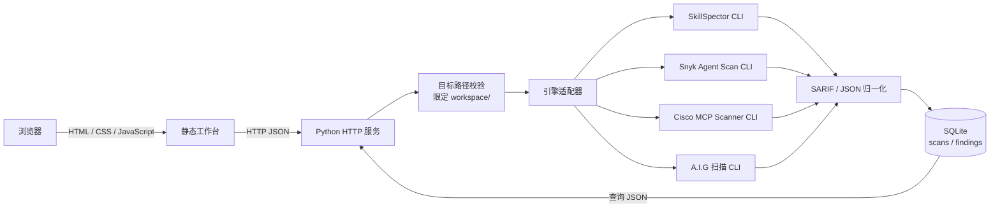

# 当前原型架构（ASGP）

本文只描述当前可运行的扫描集成原型。ASGP 的目标整体架构、数据模型、API 契约和实施阶段以仓库根目录的 `ARCHITECTURE.md`、`DATA_MODEL.md`、`API_CONTRACT.md`、`IMPLEMENTATION_PLAN.md` 为准。

## 一句话概括

当前 ASGP 原型是一个**单机扫描编排与结果复核平台**：浏览器提交扫描请求，Python 服务校验目标并调用已有扫描器 CLI，把各引擎输出归一化后存入 SQLite，再由前端展示。

它目前不是微服务集群，也不是 A.I.G Go/React 主平台的代码分支。扫描检测逻辑来自上游引擎；本平台自己实现的是 HTTP 接口、目标边界、CLI 调度、结果适配、SQLite 存储和工作台界面。

## 结构图

**一次扫描的路径：**用户在页面提交引擎 ID 和 `workspace/` 下的相对路径 → 服务校验路径和引擎约束 → 用参数数组启动对应 CLI → 解析 SARIF 或 JSON → 保存扫描摘要、原始报告和归一化发现项 → 前端刷新记录与发现项表。

## 分层说明

| 层 | 主要文件 | 职责 |
| --- | --- | --- |
| 页面层 | `web/index.html`、`web/styles.css`、`web/app.js` | 中文扫描表单、引擎状态、报告导入、扫描记录和发现项展示 |
| HTTP/API 层 | `backend/server.py` 的 `Handler` | 提供静态页面、引擎清单、摘要、扫描、导入和查询接口 |
| 安全边界 | `_safe_target()`、`_run_cli_scan()` | 只扫描配置根目录内的目标；按引擎限制输入类型和运行模式 |
| 引擎层 | `_run_cli_scan()` 和 `.venvs/` | 通过独立虚拟环境调用现成 CLI，隔离 Python 依赖版本 |
| 结果适配层 | `_sarif_findings()`、`_snyk_findings()`、`_json_findings()` | 保留引擎名称、规则 ID、原始严重级别、消息、位置和可用风险分 |
| 数据层 | `data/fusion.db` | SQLite 保存扫描、汇总、原始报告和归一化发现项 |

引擎名称、规则 ID 和风险分都作为来源数据保留。若某上游只提供分数而没有严重级别，平台显示“未评级”，不会自行推导高/中/低等级。

## 主要接口

| 方法与路径 | 用途 |
| --- | --- |
| `GET /api/health` | 服务状态、扫描目录和监听地址 |
| `GET /api/engines` | 引擎来源、许可、运行状态和执行边界 |
| `GET /api/providers` | StepFun 主用与讯飞候选的非敏感供应商 Profile |
| `GET /api/summary` | 扫描数、发现项数、高危数和最近扫描时间 |
| `GET /api/scans` | 最近扫描记录 |
| `GET /api/scans/{id}` | 单次扫描及其发现项 |
| `POST /api/scans` | 在 `workspace/` 内启动一次受支持的 CLI 扫描 |
| `POST /api/scans/import` | 导入 SARIF 或支持的扫描器 JSON，不执行目标内容 |

请求响应字段和数据库字段使用稳定的英文 key；这是机器接口协议，不随页面汉化而改变。

## 为什么每个引擎用独立虚拟环境

上游工具的 Python 依赖版本并不一致。例如不同扫描器使用不同版本的 MCP SDK、FastAPI、Pydantic 等库。把它们塞进同一个 Python 环境容易发生版本冲突。因此 `scripts/setup-engines.sh` 为每个 CLI 建立单独的 `.venvs/<engine>/`，`scripts/run-local.sh` 只把这些 CLI 放进调度服务的 `PATH`。

虚拟环境只隔离 Python 包版本，**不等同于操作系统沙箱**。CLI 子进程仍以服务进程的操作系统权限运行，并继承服务环境变量。

## 结果模型

- `scans`：扫描 ID、引擎、目标、状态、开始/结束时间、发现项数量、严重级别汇总和原始报告。
- `findings`：引擎、规则 ID、标题、严重级别、风险分、说明、文件/行号、指纹和附加元数据。
- SARIF 2.1.0 是首选互通格式；对特定 JSON 输出则使用引擎适配器。
- 原始报告只保存在本机 SQLite 中，界面查询返回归一化发现项，不直接回显整份原始文件。

## 当前引擎范围

- **SkillSpector**：Skill 静态扫描，关闭 LLM 分析并输出 SARIF；OSV 查询可能访问网络。
- **Snyk Agent Scan**：当前只允许 Skill 路径，需 `SNYK_TOKEN`。它的 CLI 输出仍可能变化，所以适配器不把该 JSON 作为平台 API。
- **Cisco MCP Scanner**：只传入静态工具清单 JSON，运行 YARA 静态分析；不连接在线 MCP，不启动 stdio 命令。
- **A.I.G Skill/MCP Scan**：复用上游独立 CLI，按选定 Provider Profile 为子进程注入 `LLM_API_KEY`、`LLM_BASE_URL` 和 `LLM_MODEL`；被扫描内容会发送到配置的模型服务。
- **A.I.G Agent Scan**：CLI 已安装，但动态 Agent 测试需要运行目标配置；当前不从页面启动。
- **ToolHive**：MCP 运行时注册/网关，不是扫描引擎，目前未接入运行时流量。
- **LLM Guard**：上游已归档，当前仅登记为参考，不用于线上判定。

## 当前部署与限制

当前进程监听 `0.0.0.0:8000`，所以可通过服务器公网地址访问。**当前没有用户登录或 API 鉴权。** 这是为了本轮查看页面设置的单机原型，不适合承载敏感报告或作为面向不可信用户的服务。

扫描接口只接受 `workspace/` 下的相对路径，并将请求体限制为 8 MiB、单次 CLI 扫描限制为 300 秒。它还没有后台任务队列、分布式 worker、用户/组织权限或 OS 级沙箱。扫描器虚拟环境的依赖隔离不能替代容器、seccomp 或专用 worker 隔离。

## 建议的阅读顺序

1. 看 `web/app.js`：页面从哪些 API 读取数据，如何提交扫描和导入报告。
2. 看 `backend/server.py` 的 `Handler.do_POST()`：请求如何进入扫描/导入流程。
3. 看 `_safe_target()` 和 `_run_cli_scan()`：目标约束和各上游 CLI 参数如何落地。
4. 看 `_sarif_findings()`、`_snyk_findings()`、`_json_findings()`：不同扫描器结果如何映射到统一结构。
5. 看 `_persist_scan()`：扫描和发现项如何保存到 SQLite。
6. 看 `UPSTREAMS.md` 和 `THIRD_PARTY_NOTICES.md`：各项目在平台中的角色、许可与署名边界。
